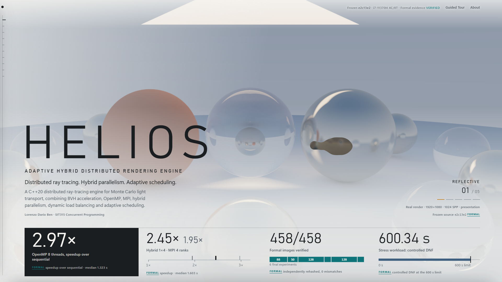
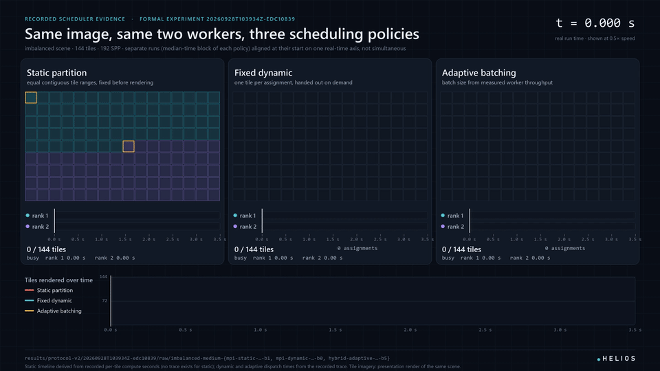

# Helios

**An adaptive hybrid distributed path tracer in C++20.** Helios renders the same image through seven parallel execution backends, from a single thread up to MPI ranks running OpenMP threads, and proves they all do the same work: every backend produces bit-identical pixels.



**[Live Observatory](https://lorenzodarioben-lgtm.github.io/HELIOS/)** · **[Video walkthrough (15 min)](https://youtu.be/HrEtUrKpa7U)** · **[Final report (PDF)](report/Helios_Submitted_Report.pdf)**

Built by Lorenzo Dario Ben as the final project for SIT315 Concurrent Programming at Deakin University.

## What it does

- **Path tracing:** Monte Carlo light transport with diffuse, metal, glass and emissive materials, next-event estimation and a median-split BVH, over six built-in procedural scenes.
- **Seven backends behind one renderer:** sequential, OpenMP, static MPI, dynamic MPI, and hybrid MPI + OpenMP in static, dynamic and throughput-adaptive modes. Every backend calls the same `render_tile` function.
- **Deterministic output:** each camera sample seeds its own random stream from (seed, pixel, sample), so the image does not depend on which thread or rank rendered it. Exact image equality becomes a correctness test for every parallel strategy.
- **Its own scheduler:** an MPI coordinator/worker protocol hands out tile batches. The adaptive mode sizes each batch from the worker's measured throughput and shrinks batches as the queue empties.
- **Measured, not guessed:** per-tile costs, assignment traces, MPI call times and completion tails are recorded for every run.

## Results

Measured on one laptop (Intel Core i7-11370H, 4 cores / 8 threads, 16 GB, Windows 11, GCC 14.1, Microsoft MPI 10.1). Each condition had one warm-up and seven measured runs in randomised blocks, and is reported as a median with a 95% bootstrap interval.

| Finding | Result |
|---|---|
| Best speedup | **2.97×** with OpenMP on 8 logical threads (1.323 s against 3.933 s sequential) |
| Best four-core layout | Hybrid 1 rank × 4 threads: **2.45×**, 20.7% faster than OpenMP with 4 threads in every block |
| Dynamic vs static scheduling | **27.5% to 31.8% faster** on every natural scene; worker imbalance cut from 0.45–0.59 to below 0.01 |
| Adaptive batching | 31% to 81% fewer scheduler assignments with the same balance, but **no consistent wall-clock gain** on a single machine |
| Performance investigation | A 43% hybrid slowdown was traced to two real defects: false sharing in per-thread counters, and a heap allocation on every BVH query. Fixing the second made the sequential renderer **44.6% faster**. |
| Correctness | All seven backends give identical images; **458 of 458** formal benchmark images were independently rehashed with no mismatch |
| Stress test | A 1.89-billion-sample render was stopped at a supervised 600-second limit (did not finish, no crash) |

The full method, results, statistics and limitations are in the [final report](report/Helios_Submitted_Report.pdf).

## The Helios Observatory

The Observatory is an interactive, offline web page that explores the recorded evidence:
- a **Workload Microscope** with per-tile cost heatmaps;
- a **Scheduler Lab** that replays recorded static, dynamic and adaptive runs side by side;
- a **Performance Lab**, a **correctness wall** and the stress-test record.

Every number it shows is read from the saved experiment files. It also features a custom **liquid cursor**: a WebGL inversion lens that stretches with motion and sheds small goo droplets on fast gestures. It was developed in its own lab ([`labs/liquid-cursor/`](labs/liquid-cursor/README.md)).

Open it online at **[lorenzodarioben-lgtm.github.io/HELIOS](https://lorenzodarioben-lgtm.github.io/HELIOS/)**, or locally by opening `assets/observatory/index.html` in Edge or Chrome.



## Build

Requirements: GCC with OpenMP (tested with MSYS2 MinGW-w64 GCC 14.1) and, for the MPI backends, an MPI implementation with `mpicxx` (tested with Microsoft MPI 10.1). From the repository root, in PowerShell:

```powershell
./scripts/build.ps1 -Configuration release
```

This builds `helios.exe`, `helios_mpi.exe` and `helios_tests.exe`. The equivalent direct commands are:

```powershell
g++ -std=c++20 -Wall -Wextra -Wpedantic -Wconversion -fopenmp -DHELIOS_OPENMP=1 -I include -O2 -DNDEBUG src/core.cpp src/main.cpp -o build-release/helios.exe
mpicxx -std=c++20 -Wall -Wextra -Wpedantic -Wconversion -fopenmp -DHELIOS_OPENMP=1 -I include -O2 -DNDEBUG -DHELIOS_MPI=1 src/core.cpp src/main.cpp -o build-release/helios_mpi.exe
```

A CMake configuration is included but has not been tested.

## Run

```powershell
New-Item -ItemType Directory -Force out | Out-Null
./build-release/helios.exe render --backend sequential --scene showcase --width 800 --height 450 --spp 64 --max-depth 8 --seed 42 --output out/sequential.ppm --stats-json out/sequential.json
./build-release/helios.exe render --backend openmp --threads 8 --scene showcase --width 800 --height 450 --spp 64 --max-depth 8 --seed 42 --output out/openmp.ppm
mpiexec -n 3 ./build-release/helios_mpi.exe render --backend hybrid-adaptive --threads 2 --scene showcase --width 800 --height 450 --spp 64 --max-depth 8 --seed 42 --output out/adaptive.ppm --trace-csv out/adaptive.csv
```

Every backend prints the same image hash for this configuration: `57881d257daf2474`. Run `helios.exe --help` for all options and scenes. The dynamic and adaptive MPI backends need at least two ranks, because rank 0 coordinates.

## Test

```powershell
./build-release/helios_tests.exe
python scripts/validate_cli.py --exe ./build-release/helios.exe
python scripts/validate_bvh.py --exe ./build-release/helios.exe
python scripts/validate_backends.py --exe ./build-release/helios.exe --mpi-exe ./build-release/helios_mpi.exe --openmp
```

The validators check exact image equality across 11 backend, rank and thread configurations, the BVH against brute force in all six scenes, and 12 invalid command lines. `scripts/benchmark_v2.py` reruns the benchmark protocol; see [docs/BENCHMARKING.md](docs/BENCHMARKING.md).

## Repository map

| Path | Contents |
|---|---|
| [`src/`](src/), [`include/`](include/) | The renderer: geometry, BVH, scenes, sampling and `render_tile` (`core.cpp`); command line, backends and MPI scheduler (`main.cpp`) |
| [`tests/`](tests/) | Unit tests for the renderer and the benchmark analysis |
| [`scripts/`](scripts/) | Build, validators, benchmark harness, analysis, plotting and diagnostic tools |
| [`results/`](results/) | Raw and aggregated data of every benchmark run, with manifests |
| [`assets/observatory/`](assets/observatory/) | The Helios Observatory |
| [`labs/liquid-cursor/`](labs/liquid-cursor/) | Development lab of the Observatory's liquid cursor |
| [`report/`](report/) | The final report and its source |
| [`docs/`](docs/README.md) | Architecture, scheduler, benchmark and investigation notes |

## Limitations

All measurements come from one four-core laptop, with MPI communicating through shared memory. The results show how the strategies behave on that machine, not on a cluster. The scenes are procedural, MPI messages are blocking, and the BVH uses a simple median split rather than a surface-area heuristic.

## Licence

Copyright © 2026 Lorenzo Dario Ben. All rights reserved; see [LICENSE](LICENSE).
