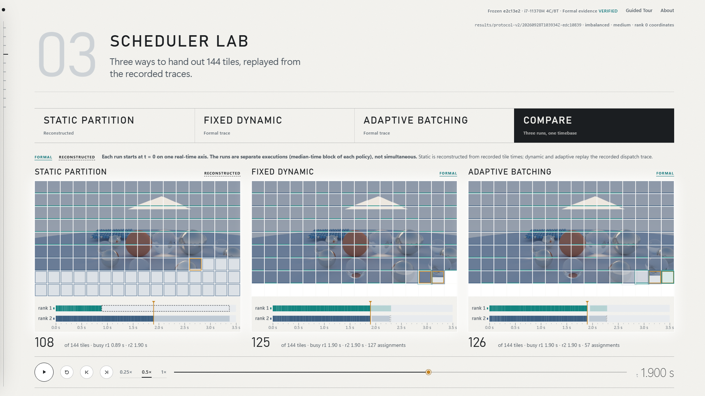

# Helios Observatory

An interactive rendering, scheduling and evidence laboratory for **Helios**, the adaptive hybrid distributed rendering engine in this repository: C++20 ray tracing for Monte Carlo light transport, with BVH acceleration, OpenMP, MPI and adaptive scheduling. It is a local, offline web page that explains the engine and its results using only the evidence already saved in the repository.



## What it is

- A **presentation and evidence layer** around the finished engine: ten pages, from rendered images to the scheduler replay, the performance results, correctness, the stress test and the provenance of every headline number.
- **Built from saved evidence.** A Python build step (`scripts/observatory/build_observatory.py`) parses the formal experiment records, telemetry, traces, manifests and presentation renders into normalised JSON. The page only displays that JSON.
- **Offline.** Plain HTML, CSS and vanilla JavaScript. No framework, no npm, no CDN, no web fonts, no network requests. The data is bundled into `data/bundle.js`, so `index.html` also opens directly from disk.

## What it is not

- **Not a benchmark runner.** It never renders, measures or reruns anything. It cannot change a Helios measurement.
- **Not a simulator.** The scheduler replay uses recorded dispatch traces. Where no trace exists (static partitioning), the timeline is rebuilt from recorded per-tile times and labelled RECONSTRUCTED.
- **Not the engine.** Helios is the C++20 code in `src/`, `include/` and `tests/`, frozen at `e2c13e2` for all final results. The Observatory is supporting tooling.

## Launch

From the repository root:

```bash
python scripts/observatory/serve.py
```

This serves the repository **read-only on 127.0.0.1** (GET/HEAD only) and opens `http://127.0.0.1:8315/assets/observatory/index.html`. Options: `--port 8315`, `--no-browser`, `--recording` (recording mode) and `--route scheduler?policy=compare` (open a deep link).

Opening `assets/observatory/index.html` directly from disk also works. The only difference is that the Correctness page then shows the build's precomputed pixel-difference count, because browsers block canvas pixel reads for `file://` images.

A one-click live check that ends by opening the Observatory on the Correctness page:

```bash
powershell -ExecutionPolicy Bypass -File scripts/helios_demo.ps1
```

It verifies the frozen source and binaries, runs the core tests and the backend validator, renders hybrid-adaptive and sequential with the same settings, compares the hashes independently and converts the result to PNG. It writes only to `%TEMP%\helios-demo`. It never runs benchmarks or the stress test.

## Pages

| Key | Section | Shows | Main evidence |
|---|---|---|---|
| 1 | 00 Overview | Full-viewport montage of real renders, evidence strip, section index, closing frame (`overview?panel=close`) | formal strong scaling, validation stack, stress manifest |
| 2 | 01 Render Lab | Six presentation renders, convergence 1 to 256 SPP with a 2× loupe, rendering pipeline (illustrative) | `assets/showcase/gallery`, `assets/showcase/convergence` |
| 3 | 02 Workload Microscope | Cost of each of the 144 tiles (time, rays, BVH visits, primitive tests, owner), static partitions, histogram | tile CSVs of formal strong scaling `20260928T102644Z-100e1393` |
| 4 | 03 Scheduler Lab | Static, fixed dynamic and adaptive replay, worker lanes, compare view, adaptive explanation, raw trace inspector (**T**) | formal scheduler experiment `20260928T103934Z-edc10839` |
| 5 | 04 Hardware & Hybrid | 4 cores / 8 logical processors, process and thread layouts, measured CPU placement, parallelism layers | stress environment record, diagnostic placement runs |
| 6 | 05 Performance Lab | Runtime, speedup, efficiency, uncertainty, weak scaling, scheduler, optimisation A/B, the hybrid-anomaly case file | final six experiments, diagnostic A/B, historical runs |
| 7 | 06 Correctness | Seven backends with one hash, live pixel difference, validation stack | `assets/showcase/correctness`, validators re-run at build |
| 8 | 07 Stress & Limits | The 600.34 s DNF, recorded commands, outcomes, validity constraints | `results/stress/20260928T111419Z-5832e956` |
| 9 | 08 Provenance | Six evidence chains, the experiment browser, the source inspector | all of the above, plus `git show e2c13e2:<file>` |
| 0 | 09 Technical Q&A | 15 engineering questions on design decisions, trade-offs and limitations, each with a short answer, evidence, a labelled trade-off, limitation or context note, and a Show evidence link (`#defence`, alias `#qna`) | report, extracted values |

Every page and state is a deep link, for example `#scheduler?policy=adaptive&t=1.2`, `#workload?metric=owner&overlay=4`, `#performance?view=case&era=historical` or `#provenance?panel=code&snippet=batch_size`.

Keys: **1–9, 0** jump to sections (shown when the slim left rail slides out on hover or keyboard focus); **P** or the **Guided Tour** button starts the guided tour (**← →** move through 11 curated items ending on the closing frame; **Esc** exits; `?mode=present&item=N` opens item N); **Space** plays or pauses the current animation; **T** opens the trace inspector on the Scheduler Lab. Recording mode is an author tool for screen capture with no public control: `?mode=recording` (or `serve.py --recording`) enlarges text and hides the navigation rail (move the pointer to the left edge to summon it). The About drawer (closed by About, Esc, a click outside it or any navigation) gives the project identity and shows the frozen source, the repository HEAD when the data was built, the build time, the protocol and the environment.

## Where the data comes from

`scripts/observatory/extract_evidence.py` reads, and never writes:

- `results/protocol-v2/` — the six final formal experiments and the six historical ones (manifests, aggregates, raw `stats.json`, `tiles.csv`, `trace.csv`, PPM images);
- `results/diagnostic/` — the optimisation A/B, the false-sharing probe and the CPU-placement and affinity runs;
- `results/stress/20260928T111419Z-5832e956/` — the stress manifest, environment and logs;
- `results/screenshot/showcase.json` — the recorded end-to-end hybrid-adaptive run;
- `assets/showcase/` — presentation renders (gallery, convergence, correctness);
- the frozen source (`git show e2c13e2:<file>`) for code excerpts, and `report/HELIOS_FINAL_REPORT.md` to confirm that each claimed value appears in the report.

At build time it also re-runs the validators (core tests, CLI, BVH, backend, analysis tests) and independently rehashes all 458 formal images of the final six experiments plus the 458 historical ones. Validators write only to temporary directories. Every displayed number is parsed from these files; none are typed in by hand. Details, file by file: [docs/OBSERVATORY_ARCHITECTURE.md](../../docs/OBSERVATORY_ARCHITECTURE.md).

## Evidence classifications

Every chart, figure and panel where the source could be ambiguous carries one of these labels:

| Label | Meaning |
|---|---|
| FORMAL | Protocol V2 evidence on the frozen source `e2c13e2` (warm-up, 7 randomised blocks, paired bootstrap intervals, hash-verified images) |
| DIAGNOSTIC | Exploratory runs used to investigate; not formal results |
| HISTORICAL | Formal runs on the pre-fix renderer, kept and superseded; never mixed with final results |
| PRESENTATION | Renders made for show; their runtimes are not benchmark data |
| RECONSTRUCTED | Derived from recorded measurements rather than recorded directly (the static scheduler timeline) |
| ILLUSTRATIVE | Explanation only (pipeline, layouts, parallelism layers); nothing measured |

## Relationship to the frozen source

All final results come from the source frozen at `e2c13e2204ca28aecb90d2d33703587bd16027a1`. The build refuses to run if `src/`, `include/` or `tests/` differ from that commit. The edge line at the top right shows the frozen source, the platform and whether every formal image was verified. The Observatory changed no file under `src/`, `include/`, `tests/`, `results/` or `report/`; `provenance/pre-sprint-integrity.json` records SHA-256 hashes of 11,214 protected files, and the validator checks them.

## How the scheduler replay works

- **Dynamic and adaptive** runs record a dispatch trace (`*.trace.csv`: worker, first tile, tile count, assignment and completion times, the coordinator's rate estimate) and per-tile telemetry (`*.tiles.csv`: worker, compute seconds, rays, BVH counters). The replay places each batch at its recorded dispatch time. Tiles inside a batch run back to back using their recorded compute times, starting at the dispatch time. The validator checks that each derived batch end is not after its recorded receipt and that the trace, the tile ownership and the tile file agree.
- **Static** partitioning sends no dispatch messages, so there is no trace. Its timeline is **reconstructed**: each worker's tiles run back to back in tile order with their recorded compute times. This is labelled RECONSTRUCTED wherever it appears, and no dispatch events are invented.
- Each policy uses the **median-time block** of the seven measured runs (static block 1, dynamic block 0, adaptive block 5), so the replay shows a typical run, not the best one.
- In the compare view the three runs share one real-time axis starting at t = 0. They are separate executions, not simultaneous ones.

## Liquid cursor

On a desktop with a fine pointer, the Observatory uses the experimental liquid cursor: `liquid-cursor.js`, the visually approved *Reference goo · balanced* cursor of the liquid cursor lab (`labs/liquid-cursor/`, commit `9cce8a5`). It is a Santioni-style lens that stretches with motion and, on fast gestures, trails a short path-following goo tail that may shed a few beads. It is drawn with `mix-blend-mode: difference`, so it inverts whatever is under it.

- **Self-contained:** one classic script with inline shaders. It loads after `app.js`, needs nothing from `labs/` and works from `file://` and localhost alike.
- **An observer only:** `pointer-events: none`, passive listeners and no keyboard handling. Links, buttons and the page's own shortcuts behave exactly as before.
- **Native cursor kept:** the native cursor stays until the liquid cursor is running and the pointer has moved. It returns at once whenever the liquid cursor stops.
- **Precision controls:** the native cursor and no goo over the convergence view and its wipe handle, the Workload tile canvas, the Scheduler timeline and scrubber, selects and form fields, code blocks and copy paths. Links, buttons, tabs, chart bars and clickable rows get a slight hover growth instead.
- **Off (native cursor) when:**
  - `?cursor=off` (the kill switch)
  - recording mode (`?mode=recording`; add `&cursor=on` to opt in)
  - no fine pointer, `prefers-reduced-motion: reduce` or forced colours
  - no WebGL2, a shader failure, a lost context, or any runtime error
- **Status:** `window.HeliosLiquidCursor.status()` reports whether it runs and why not. `?cursor=test` adds frame-exact hooks for the lab's tools without changing what is drawn.
- **Checks:**
  - `scripts/observatory/test_liquid_cursor.py` holds the static contract.
  - `labs/liquid-cursor/tools/check-observatory.mjs` runs the integration checks in a real browser.
  - `labs/liquid-cursor/tools/verify-production.mjs` checks the runtime against the lab preset, state for state and pixel for pixel.
- **Scrolling:** wheel-scrolling under the liquid cursor costs frame rate, because Chromium has to composite the difference blend over moving content. It is measured with `labs/liquid-cursor/tools/measure-scroll.mjs`. If that matters for a session, `?cursor=off` removes it.
- **Captures:** the official screenshots and the demo video do not show it. It appears only after real pointer motion, and recording mode keeps the native cursor.

## Rebuild and validate

```bash
python scripts/observatory/build_observatory.py
python scripts/observatory/validate_observatory.py
python -m unittest discover -s scripts/observatory -p "test_*.py"
python scripts/observatory/capture_screenshots.py
```

The build writes only `assets/observatory/data/` (15 JSON files, `experiment_capsule.json` and `bundle.js`). The validator writes only `assets/observatory/validation.json`. The screenshot script writes only `assets/observatory/screenshots/`, capturing the running page with headless Microsoft Edge at 1920×1080. Tooling details: [scripts/observatory/README.md](../../scripts/observatory/README.md).

## Files

```
assets/observatory/
  index.html, styles.css, app.js     the application (no dependencies)
  liquid-cursor.js                   the liquid cursor (self-contained; see Liquid cursor above)
  data/*.json, data/bundle.js        generated by build_observatory.py; do not edit
  data/experiment_capsule.json       machine-readable summary: source, binaries, environment, experiments, verification
  provenance/pre-sprint-integrity.json  SHA-256 snapshot of protected evidence before the Observatory was built
  validation.json                    last validation result
  screenshots/*.png                  real 1920×1080 captures of the application
  media/observatory-demo.mp4         32.9 s silent demo assembled from real captured states (make_demo_video.py)
```
