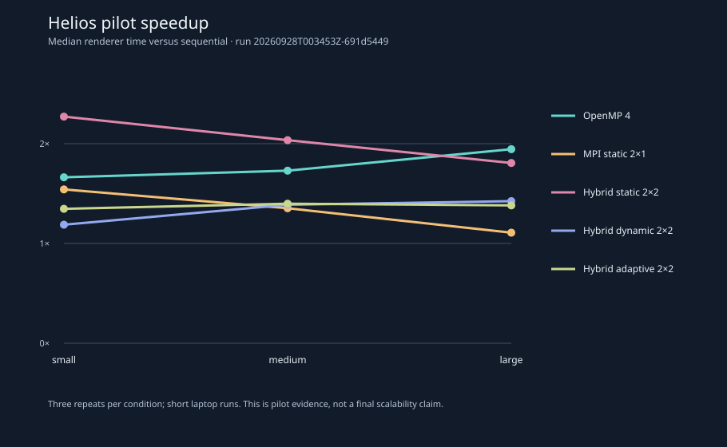

# Benchmark methodology and current measurements

## Frozen performance source and which formal experiments it supersedes

The final performance-evaluation source is **`e2c13e2`**. No performance implementation change should follow it unless a correctness bug is found. It adds two fixes, both preserving pixels and counters, on top of the historical sources:

- `dca8628`: `render_tile` per-thread counters are private to each OpenMP thread and merged once per tile. This removed alignment-dependent false sharing. It matters only for `hybrid-*` ranks with more than 1 thread.
- `e2c13e2`: `Scene::hit` traverses the BVH with a bounded fixed stack instead of allocating a heap `std::vector` for every query. This affects every backend, including sequential.

The final diagnostic A/B (`results/diagnostic/counter-fix/20260928T101701Z-0de80589`) compares both fixes with the pre-fix `6270d44`, using 7 paired blocks with identical pixels and counters in every run:

| Condition | Pre-fix | Counter fix only | Paired change, counter only (95% CI) | Both fixes | Paired change, both (95% CI) |
|---|---:|---:|---|---:|---|
| sequential | 7.222 s | 7.210 s | +0.05% (−0.88 to +1.56) | 3.991 s | −44.62% (−45.07 to −44.14) |
| OpenMP 4 | 3.755 s | 3.754 s | −0.93% (−3.62 to +4.06) | 2.030 s | −45.90% (−46.34 to −45.48) |
| MPI static 4 | 3.684 s | 3.687 s | +0.10% (−4.32 to +2.73) | 2.024 s | −44.64% (−47.29 to −44.14) |
| hybrid 1×4 | 3.751 s | 3.435 s | −8.45% (−10.54 to −5.05) | 1.597 s | −57.50% (−58.25 to −57.22) |
| hybrid 2×2 | 4.465 s | 3.782 s | −13.99% (−17.25 to −13.41) | 2.092 s | −53.36% (−53.69 to −52.47) |

The counter fix alone leaves the negative controls (sequential, OpenMP 4, MPI 4) unchanged, and every interval spans zero. The BVH-stack fix is mainly a serial per-query cost: sequential gains about as much as OpenMP 4 and MPI 4. The extra gain on the hybrid intra-tile paths is the only part that looks like a threaded effect. All historical data are preserved unchanged.

| Experiment | Design | Affected by `dca8628` (counters)? | Affected by `e2c13e2` (BVH stack)? | Reason | Status |
|---|---|---|---|---|---|
| `20260928T062641Z-d865a73c` | scheduler small, 3×1 | NO | YES | single-threaded tiles, but every BVH query changed | **historical; superseded by `20260928T104823Z-8e1c1ed4`** |
| `20260928T063038Z-301480e3` | strong medium, 11 conditions | YES (hybrid 1×4, 2×2) | YES | intra-tile threads and every BVH query | **historical; superseded by `20260928T102644Z-100e1393`** |
| `20260928T063756Z-d01e8d9f` | heterogeneity small, 3×1 | NO | YES | as above | **historical; superseded by `20260928T105023Z-1dd576e1`** |
| `20260928T064015Z-fd6ca303` | weak small, 6 conditions | YES (hybrid 2×2) | YES | as above | **historical; superseded by `20260928T103116Z-c00a63fc`** |
| `20260928T075743Z-cf62886e` | frozen scheduler medium, 3×1 | NO | YES | faster tiles change adaptive batch sizes and the overhead share | **historical; superseded by `20260928T103934Z-edc10839`** |
| `20260928T080938Z-fe56f15c` | large reflective holdout, 3×1 | NO | YES | as above | **historical; superseded by `20260928T104502Z-5e829d04`** |

"NO" is a code-path statement. Every formal experiment has now been rerun on `e2c13e2` with its historical parameters. The final evidence is the set of six new experiment IDs.

## Frozen-renderer strong scaling (`e2c13e2`)

Experiment `20260928T102644Z-100e1393` repeated the historical strong-scaling matrix on the frozen source, with the same preset, seed, warm-up, seven measured blocks and order seed 20260929. Settings: `imbalanced`, 256×144, 192 SPP, depth 8, seed 42, tile 16. It completed 88/88 commands; all hashes matched, and the verifier independently rehashed all 88 PPMs. Its manifest records HEAD `e4a219c`, whose `src/` and `include/` equal `e2c13e2`.

| Execution | Slots | Median (95% CI) | Speedup | Efficiency per slot | Historical median |
|---|---:|---|---:|---:|---:|
| Sequential | 1 | 3.933 s (3.886–4.106) | 1.00× | 1.00 | 6.279 s |
| OpenMP 1 | 1 | 3.923 s (3.888–4.093) | 1.00× | 1.00 | 6.153 s |
| OpenMP 2 | 2 | 3.304 s (3.292–3.341) | 1.19× | 0.60 | 5.170 s |
| OpenMP 4 | 4 | 2.041 s (2.008–2.164) | 1.93× | 0.48 | 3.208 s |
| OpenMP 8 logical | 8 | 1.323 s (1.300–1.381) | 2.97× | 0.37 | 2.116 s |
| MPI static 1 | 1 | 3.910 s (3.905–3.937) | 1.01× | 1.01 | 6.129 s |
| MPI static 2 | 2 | 3.304 s (3.287–3.318) | 1.19× | 0.60 | 5.090 s |
| MPI static 4 | 4 | 2.020 s (2.001–2.074) | 1.95× | 0.49 | 3.092 s |
| Hybrid 1×4 | 4 | 1.603 s (1.583–1.676) | 2.45× | 0.61 | 3.634 s |
| Hybrid 2×2 | 4 | 2.057 s (2.048–2.121) | 1.91× | 0.48 | 4.707 s |
| Hybrid 4×1 | 4 | 2.035 s (2.029–2.085) | 1.93× | 0.48 | 3.062 s |

Historical medians are from `20260928T063038Z-301480e3` on the pre-fix renderer and a different session, so they are unpaired and descriptive only. The [block-paired comparisons](../results/protocol-v2/20260928T102644Z-100e1393/aggregate/strong_paired.md) are within the new run:

| Candidate vs reference | Blocks candidate faster | Median paired change (95% CI) | Historical run |
|---|---:|---|---|
| hybrid 2×2 vs OpenMP 4 | 4/7 | −0.30% (−2.02 to +3.29) | +43.46% (+39.95 to +51.80), 0/7 |
| hybrid 2×2 vs MPI 4 | 2/7 | +1.84% (−0.19 to +4.02) | +51.13% (+49.57 to +55.68), 0/7 |
| hybrid 1×4 vs OpenMP 4 | 7/7 | −20.66% (−25.95 to −18.80) | +13.47% (+6.81 to +17.51), 0/7 |
| hybrid 4×1 vs MPI 4 | 0/7 | +1.01% (+0.54 to +1.96) | +1.03% (−3.02 to +2.77), 3/7 |
| OpenMP 4 vs MPI 4 | 2/7 | +0.34% (−1.40 to +8.15) | +6.56% (+4.13 to +7.78), 1/7 |
| OpenMP 8 vs OpenMP 4 | 7/7 | −34.69% (−39.92 to −32.31) | −34.36% (−37.63 to −23.38), 7/7 |

Historical paired values come from the same tool applied to the old run's raw records.

Interpretation:
- **Hybrid 2×2 no longer carries a resolvable penalty** against OpenMP 4 or MPI 4. Both intervals include zero, although the MPI interval barely does. Its within-tile efficiency, computed from the per-tile costs, rose from 0.52 to 0.74, against 0.78–0.80 for single-thread-per-tile 4-slot layouts. A small intra-tile cost therefore remains.
- **Hybrid 1×4 is now the fastest 4-slot layout.** Splitting every tile across 4 threads avoids the static-partition imbalance that OpenMP 4 and MPI 4 inherit: their heaviest contiguous quarter caps the speedup at about 2.34×.
- **Hybrid 4×1 converges on MPI 4** but costs a small, consistent +1.0% (about 22 ms); the cause is not isolated.
- **SMT helps on this ray-tracing workload.** Eight logical threads beat four by 34.7% in 7/7 blocks, but per-logical-slot efficiency falls to 0.37.
- **Efficiency is limited mainly by static partitioning** of a deliberately imbalanced scene: compute imbalance was 0.56–0.71 for the static layouts. The dense region falls largely in one half, so a 2-way split caps the speedup at about 1.23×. The observed 1.19× (0.60 efficiency) is close to that cap.

## Frozen-renderer weak scaling (`e2c13e2`)

Experiment `20260928T103116Z-c00a63fc` repeated the historical weak matrix: small preset, SPP proportional to slots, order seed 20261001. It completed 50/50 records with 50 independent PPM hashes. Weak efficiency (one-slot median ÷ scaled median) was:

| Condition | New | Historical |
|---|---:|---:|
| OpenMP 2 | 0.61 | 0.60 |
| OpenMP 4 | 0.49 | 0.49 |
| MPI 2 | 0.61 | 0.61 |
| MPI 4 | 0.49 | 0.52 |
| Hybrid 2×2 | **0.48** | 0.33 |

Hybrid 2×2 now matches the other 4-slot layouts. The unchanged OpenMP and MPI efficiencies are expected, because the BVH-stack fix speeds every condition by a similar factor.

## Frozen-renderer scheduler evaluations (`e2c13e2`)

Each experiment reused the historical command, preset, scene order, order seed, trace mode and timeout. The scheduler algorithm and adaptive defaults (fixed batch 1; adaptive initial batch 2, 50 ms target, cap 8) are unchanged. Every record succeeded, and the verifier independently rehashed every PPM:

| New ID | Design | Records | Historical ID |
|---|---|---:|---|
| `20260928T103934Z-edc10839` | medium, 4 scenes | 128/128 | `20260928T075743Z-cf62886e` |
| `20260928T104502Z-5e829d04` | large reflective holdout, 512 SPP | 32/32 | `20260928T080938Z-fe56f15c` |
| `20260928T104823Z-8e1c1ed4` | small, 4 scenes | 128/128 | `20260928T062641Z-d865a73c` |
| `20260928T105023Z-1dd576e1` | heterogeneity, rank 1 slowed 2× | 32/32 | `20260928T063756Z-d01e8d9f` |

Block-paired median runtime changes, with 95% bootstrap intervals over 7 blocks:

| Experiment / scene | Fixed dynamic vs static | Adaptive vs static | Adaptive vs fixed dynamic | Adaptive / fixed assignments |
|---|---|---|---|---|
| medium imbalanced | −31.84% (−35.27, −29.23) | −32.18% (−33.96, −30.93) | −0.64% (−2.59, +3.84) | 73 / 144 |
| medium reflective | −27.52% (−29.71, −26.09) | −27.80% (−30.08, −26.05) | +0.18% (−3.93, +0.67) | 69 / 144 |
| medium scheduler_stress | −30.42% (−31.33, −29.48) | −31.68% (−32.57, −29.56) | −0.68% (−2.82, +1.24) | 79 / 144 |
| medium uniform | −27.76% (−29.57, −25.22) | −28.86% (−29.86, −26.68) | **−2.73% (−4.22, −1.60)** | 36 / 144 |
| large reflective | −28.42% (−28.79, −26.83) | −26.89% (−27.48, −25.71) | **+1.83% (+0.15, +2.37)**, +0.088 s | 100 / 144 |
| small imbalanced | −31.27% (−34.21, −27.02) | −32.49% (−34.62, −31.64) | −1.39% (−6.34, +2.61) | 31 / 144 |
| small reflective | −28.18% (−30.69, −25.65) | −30.33% (−31.95, −27.94) | +0.30% (−3.50, +0.52) | 29 / 144 |
| small scheduler_stress | −29.03% (−31.96, −27.22) | −30.12% (−33.52, −24.23) | +2.69% (−2.54, +9.00) | 35 / 144 |
| small uniform | −27.79% (−31.60, −27.18) | −29.43% (−30.15, −28.65) | −1.18% (−5.38, +1.58) | 28 / 144 |
| heterogeneity (2× slow rank) | −12.06% (−15.71, −6.87) | −11.71% (−13.17, −6.93) | −0.06% (−3.70, +3.42) | 40 / 144 |

Interpretation:
- **Dynamic scheduling beats static partitioning in every scene and preset**, with every interval excluding zero. The relative gain (about 27–32% on natural scenes) is somewhat smaller than on the pre-fix renderer (about 29–39%): tiles are now about 45% cheaper, while static's partition imbalance is unchanged.
- **Adaptive batching has no consistent advantage over fixed batch-1 dynamic.** Eight of ten intervals include zero. Medium uniform favours adaptive (−2.7%, about −0.03 s), and the large holdout favours fixed (+1.8%, about +0.09 s). On the pre-fix renderer, medium uniform had the opposite sign (+1.66%). Adaptive still issues far fewer assignments, but on this single host that saves only milliseconds.
- Static compute imbalance (max/mean − 1) was 0.45–0.59 on natural scenes, against at most 0.006 for both dynamic modes. Under the 2× heterogeneity treatment, the dynamic modes deliberately gave the slowed rank fewer tiles: 47–52 of 144, against static's 72. Their compute-only imbalance was therefore 0.32–0.34, but their compute-plus-delay imbalance was only 0.004–0.010, against 0.28 for static.

Report-ready tables and figures for the medium run, plus the new strong and weak runs, are under [`report/assets/20260928T103934Z-edc10839/`](../report/assets/20260928T103934Z-edc10839/README.md).

## Frozen medium natural-scene scheduler evaluation (historical, pre-fix renderer; superseded above)

Experiment `20260928T075743Z-cf62886e` under `results/protocol-v2/` used the [frozen candidate](FROZEN_EVALUATION_CANDIDATE.md) without changing adaptive defaults. It covered `imbalanced`, `reflective`, `scheduler_stress`, and `uniform` at 256×144, 192 SPP, depth 8, tile 16, seed 42. Each condition received one warm-up and seven measured block-randomized runs. All 128 commands succeeded, the within-scene image hashes agreed, and `scripts/verify_experiment.py` independently matched all 128 local PPM pixel hashes. Dynamic/fixed and adaptive each used two rendering ranks plus a coordinator; static used two rendering ranks plus a coordinator-only rank. Detailed assignment traces and tile metrics are saved for every dynamic run. The [generated scheduler table](../report/assets/20260928T075743Z-cf62886e/scheduler.md), [paired-effect table](../report/assets/20260928T075743Z-cf62886e/paired.md), and [zero-baseline runtime figure](../report/assets/20260928T075743Z-cf62886e/scheduler-runtime.svg) derive from the saved records.

Fixed dynamic versus static coordinator-only had paired median runtime reductions of 36.84% on `imbalanced` (95% CI −38.74 to −35.85%), 33.11% on `reflective` (−35.38 to −30.91%), 38.85% on `scheduler_stress` (−41.33 to −36.13%), and 32.72% on `uniform` (−33.61 to −29.17%). The corresponding median absolute savings were 1.873, 1.338, 2.402, and 0.875 s per render. Adaptive also substantially beat static across all four scenes; these findings support dynamic redistribution as the major measured improvement.

Adaptive versus fixed dynamic had paired median changes of **+2.87%** on `imbalanced` (95% CI −3.16 to +4.99%; +0.092 s), **−1.20%** on `reflective` (−2.61 to +3.50%; −0.032 s), **+1.05%** on `scheduler_stress` (−4.40 to +3.49%; +0.040 s), and **+1.66%** on `uniform` (+0.43 to +2.48%; +0.030 s). Positive means adaptive was slower. The first three intervals cross zero: **no clear difference was established under this experiment**, which does not prove equivalence. The uniform interval is above zero, but its absolute effect is about 30 ms on a 1.8 s render. There is no consistent adaptive wall-clock advantage to claim.

Adaptive used median 92, 89, 95, and 81 assignments across the four scenes, versus fixed dynamic's 144 each. Both dynamic modes had near-zero active-worker compute imbalance; static medians were roughly 0.42–0.55. Adaptive and fixed dynamic had similar batch-boundary 90% tails in each scene (about 0.44/0.44 s imbalanced, 0.34/0.34 reflective, 0.53/0.51 stress, and 0.20/0.20 uniform). Median coordinator handling was less than 1 ms per render and summed MPI send/receive-call occupancy about 1–2 ms in these dynamic runs. Reduced dispatch/receive traffic therefore has little room to pay back late-batch variation or ordinary run noise on this single host. This interpretation is bounded by the timer definitions: blocking MPI-call timing is not pure network time, and the 90% tail has batch-granularity limitations described in [the policy audit](ADAPTIVE_POLICY_AUDIT.md).

## Separate large reflective holdout (historical, pre-fix renderer; superseded above)

Experiment `20260928T080938Z-fe56f15c` used the same frozen binaries and scheduler parameters on `reflective` at **512 SPP**, a sampling level not used in the diagnostic sweeps. It completed one warm-up plus seven randomized measured blocks for each of sequential, static coordinator-only, fixed dynamic, and adaptive: 32/32 commands and 32/32 independently rehashed PPMs passed. Median render times were sequential **13.924 s**, static **11.457 s**, fixed dynamic **7.681 s**, and adaptive **7.493 s**. The [large runtime plot](../results/protocol-v2/20260928T080938Z-fe56f15c/plots/median-runtime.svg) and [raw-derived summary](../results/protocol-v2/20260928T080938Z-fe56f15c/aggregate/summary.json) preserve all observations and intervals.

The primary **paired** adaptive/fixed result was **+0.69%** median relative runtime change (95% bootstrap CI −3.26 to +3.52%), or **+0.065 s** median absolute change (CI −0.251 to +0.332 s). The adaptive median *by itself* is lower than the fixed median, but the block-matched median difference has the opposite sign. These are different statistics; the predeclared paired comparison controls block drift and establishes **no clear difference**. Two late blocks were slower for both dynamic policies and remain included. Fixed versus static saved a paired median 31.77% (CI 18.91–36.27% faster; 3.467 s median absolute saving), and adaptive versus static saved 31.36% (CI 18.16–35.66% faster; 3.470 s). Active-worker compute imbalance was about 0.005 for both dynamic modes versus 0.469 static. Adaptive dispatched median 126 batches versus fixed 144; this longer workload left less room for batching than medium reflective (89 adaptive batches). Median batch-boundary tail was 0.966 s adaptive versus 0.952 s fixed, and last-worker spread was about 0.072 versus 0.077 s. The large holdout supports the dynamic-over-static result while leaving the adaptive-versus-fixed effect unresolved.

## Protocol V2: natural-scene scheduler comparison (historical, pre-fix renderer; superseded above)

Protocol V2 definitions, timing boundaries, calibrated presets, resource accounting, and limitations are in [BENCHMARKING.md](BENCHMARKING.md). The first final-candidate experiment is `20260928T062641Z-d865a73c` under `results/protocol-v2/`. It used the 256×144, 64-SPP small preset, depth 8, seed 42, one warm-up and seven measured blocks per condition, with a recorded randomized order seed of 20260928. All 128 commands completed, and no image hash differed from the sequential reference. Every MPI policy used three total ranks, two rendering ranks, and one thread per rank; static used `--coordinator-only`. These are single-host renderer timings, not MPI startup-inclusive process timings.

| Scene | Sequential median | Static median | Fixed dynamic median | Adaptive median | Adaptive change vs fixed dynamic |
| --- | ---: | ---: | ---: | ---: | ---: |
| uniform | 1.1715 s | 0.8894 s | 0.6094 s | 0.6191 s | 1.6% slower |
| imbalanced | 2.0781 s | 1.6627 s | 1.0852 s | 1.0890 s | 0.4% slower |
| reflective | 1.7257 s | 1.3735 s | 0.9428 s | 0.9207 s | 2.3% faster |
| scheduler_stress | 2.4068 s | 1.9635 s | 1.2590 s | 1.2962 s | 3.0% slower |

The median 95% bootstrap interval for the `scheduler_stress` fixed dynamic condition was 1.2370–1.2752 s; adaptive was 1.2707–1.3030 s. For `reflective`, fixed dynamic was 0.9233–0.9482 s and adaptive was 0.9082–0.9387 s. A paired-by-block bootstrap of `adaptive time / dynamic time - 1` yielded a median of −1.14% on `reflective` (95% percentile interval −4.49% to −0.43%), while the intervals for the other three scenes included zero. Seven blocks on one laptop support only a modest scene-specific observation, not a general adaptive advantage. The full per-condition and paired intervals, means, ranges, standard deviations, speedups, and efficiency values are generated from raw records in `aggregate/summary.csv` and `aggregate/summary.json` under the same experiment ID.

Static worker compute imbalance, defined as `max / mean - 1` across the two rendering ranks, was 0.423 on `uniform`, 0.568 on `imbalanced`, 0.467 on `reflective`, and 0.561 on `scheduler_stress`. Fixed dynamic reduced the same metric to 0.002–0.005, and adaptive to 0.001–0.006. `uniform` names the scene construction, not an assurance that every tile has equal path-tracing cost. Dynamic scheduling balanced this row-major tile order well; adaptive batch reduction cut dispatches from 144 per image to roughly 30–50 but did not show a consistent runtime advantage over one-tile dynamic scheduling. Scheduler overhead and pure network time are not separately measured, so the small policy differences should not be assigned to one cause.

The measured [runtime plot](../results/protocol-v2/20260928T062641Z-d865a73c/plots/median-runtime.svg), [compute-imbalance plot](../results/protocol-v2/20260928T062641Z-d865a73c/plots/compute-imbalance.svg), and [scheduler-stress adaptive timeline](../results/protocol-v2/20260928T062641Z-d865a73c/plots/scheduler_stress-small-hybrid-adaptive-r3-t1-all-b0/assignment-timeline.svg) are generated from that experiment's raw telemetry. The same run has measured tile ownership, per-worker tile count, and batch-size-over-time SVGs.

## Separate medium scheduler diagnostics (exploratory)

Four bounded medium-workload studies were saved under `results/diagnostic/adaptive-v3/`; none is treated as final-candidate performance proof. The core comparison ID is `20260928T073928Z-ca32eece`, fixed-size sweep `20260928T074207Z-555c6e66`, small adaptive sensitivity `20260928T074641Z-eaf2fedd`, and trace-mode comparison `20260928T074937Z-f3ae58ea`. Each has three measured blocks, one warm-up, exact commands, source/binary hashes, 256×144 at 192 SPP, and same-image hash checks. Do not compare condition medians across the four independently timed studies as paired effects.

The fixed-size sweep found batch 1's median to be fastest among 1/2/4/8/16/32 on both imbalanced (3.177 s) and scheduler_stress (3.775 s). Larger batches cut assignments and assignment-receive wait by milliseconds but often raised last-worker completion spread by tenths of a second. On imbalanced, batch 8 used 18 instead of 144 assignments, yet median wall time was 3.501 s and last-worker spread 0.461 s versus 0.013 s at batch 1. Coordinator handling and MPI send/receive occupancy were each roughly millisecond scale in these dynamic runs. A 25/50/100 ms adaptive target and initial batch 1/2/4 did not yield a stable monotonic response. The adaptive algorithm and default parameters were left unchanged for the [frozen medium evaluation](FROZEN_EVALUATION_CANDIDATE.md). The exact trace and metric caveats are in [the audit](ADAPTIVE_POLICY_AUDIT.md).

## Protocol V2: medium-workload strong scaling (historical, pre-fix renderer; superseded above)

Experiment `20260928T063038Z-301480e3` under `results/protocol-v2/` held `imbalanced`, 256×144, 192 SPP, depth 8, seed 42 constant. It completed 88/88 commands (one warm-up and seven measured runs across 11 conditions). All image hashes matched; the independent integrity verifier also recomputed all 88 local PPM pixel hashes with zero errors. The sequential median was **6.2788 s** with a 95% median bootstrap interval of 6.1985–6.3869 s.

| Execution | Rendering slots | Median | Speedup vs sequential | Efficiency per rendering slot |
| --- | ---: | ---: | ---: | ---: |
| OpenMP 1 thread | 1 | 6.1531 s | 1.02× | 1.02 |
| OpenMP 2 threads | 2 | 5.1700 s | 1.21× | 0.61 |
| OpenMP 4 threads | 4 | 3.2083 s | 1.96× | 0.49 |
| OpenMP 8 logical threads | 8 | 2.1158 s | 2.97× | 0.37 |
| MPI static 1 rank | 1 | 6.1290 s | 1.02× | 1.02 |
| MPI static 2 ranks | 2 | 5.0899 s | 1.23× | 0.62 |
| MPI static 4 ranks | 4 | 3.0922 s | 2.03× | 0.51 |
| Hybrid static 1×4 | 4 | 3.6344 s | 1.73× | 0.43 |
| Hybrid static 2×2 | 4 | 4.7068 s | 1.33× | 0.33 |
| Hybrid static 4×1 | 4 | 3.0617 s | 2.05× | 0.51 |

On this workload, OpenMP 8 used the laptop's eight *logical* processors and had the shortest median; its lower per-slot efficiency does not imply eight physical cores. Among four-slot configurations, hybrid 4×1 and MPI 4×1 were close, OpenMP 4 was slightly slower, and hybrid 2×2 was markedly slower. The hybrid path starts a parallel region inside each tile. This experiment alone does not isolate that cost, but its per-tile records show that two threads per tile reached only 0.52 parallel efficiency, while the 2×2 static partition's ideal critical path (2.47 s) was no worse than MPI 4's (2.55 s). Later diagnostics traced part of this loss to false sharing of per-thread counters inside `render_tile`, an effect that depends on heap alignment. They also found that requested `spr:p` affinity places each two-thread rank on a single SMT core. See the [hybrid audit](HYBRID_TOPOLOGY_AUDIT.md). The formal 4.707 s value was not reproduced by rebuilding its source later and is not fully attributed. The [measured runtime chart](../results/protocol-v2/20260928T063038Z-301480e3/plots/median-runtime.svg) and full aggregate carry all intervals and dispersion statistics. No worker binding or thermal control was applied.

## Protocol V2: synthetic heterogeneous worker (historical, pre-fix renderer; superseded above)

Experiment `20260928T063756Z-d01e8d9f` under `results/protocol-v2/` deliberately slowed rank 1 after each tile with `--slow-factor-milli 2000`. This is a **synthetic heterogeneous-worker experiment** on `scheduler_stress` small, not evidence of natural hardware heterogeneity. The active delay tracked rank 1's measured tile compute time: the median `stall_seconds / compute_seconds` was approximately 1.000 for each MPI policy (all measured ratios 1.000–1.007). It used the same three-rank/two-rendering-slot scheduler matrix, with one warm-up and seven measured blocks; all 32 commands and independently checked local image hashes passed.

| Policy | Median render time | Rank 1 / rank 2 median tile count | Effective-work imbalance |
| --- | ---: | ---: | ---: |
| Static coordinator-only | 2.0721 s | 72 / 72 | 0.279 |
| Fixed dynamic | 1.6714 s | 48 / 96 | 0.007 |
| Adaptive | 1.7393 s | 49 / 95 | 0.006 |

Both dynamic policies shifted about two thirds of tiles to the unslowed rank and nearly equalized `compute + injected delay` across active workers. Adaptive made a median 65 batch assignments versus fixed dynamic's 144, but its paired-by-block median runtime was 2.68% slower than fixed dynamic (95% percentile bootstrap interval 1.01–8.64% slower). The control natural-scene run `20260928T062641Z-d865a73c` preceded this treatment, so control-to-treatment differences can also reflect time/thermal drift; the within-treatment policy comparison is block-paired. Static's natural spatial imbalance happened to leave the slowed rank with less compute work, partly offsetting the injected delay. The [treatment timeline](../results/protocol-v2/20260928T063756Z-d01e8d9f/plots/scheduler_stress-small-hybrid-adaptive-r3-t1-all-b0/assignment-timeline.svg) and [tile-count chart](../results/protocol-v2/20260928T063756Z-d01e8d9f/plots/scheduler_stress-small-hybrid-adaptive-r3-t1-all-b0/worker-tile-count.svg) show actual assignments.

## Protocol V2: single-host weak scaling (historical, pre-fix renderer; superseded above)

Experiment `20260928T064015Z-fd6ca303` under `results/protocol-v2/` used `imbalanced`, 256×144, depth 8, and 64 SPP per rendering slot. The one-slot sequential case used 64 SPP; two-slot cases used 128; four-slot cases used 256. Two additional sequential renders at 128 and 256 SPP supplied same-workload correctness hashes and were excluded from timing aggregates. One warm-up and seven measured blocks were run for each of six timed conditions; all 50 records and local PPM hashes passed verification. This tests *one laptop*, not cluster weak scalability.

| Execution | Slots | SPP | Median time | Weak efficiency vs one slot |
| --- | ---: | ---: | ---: | ---: |
| Sequential | 1 | 64 | 2.0662 s | 1.00 |
| OpenMP 2 | 2 | 128 | 3.4154 s | 0.60 |
| MPI static 2 | 2 | 128 | 3.3734 s | 0.61 |
| OpenMP 4 | 4 | 256 | 4.1811 s | 0.49 |
| MPI static 4 | 4 | 256 | 4.0024 s | 0.52 |
| Hybrid static 2×2 | 4 | 256 | 6.2237 s | 0.33 |

Work per rendering slot was approximately constant by SPP, but image setup, gathering, memory effects, scheduling, and parallel-region costs do not scale identically. The [runtime chart](../results/protocol-v2/20260928T064015Z-fd6ca303/plots/median-runtime.svg) and raw-derived aggregate record intervals and dispersion. One OpenMP 4 measurement reached 5.667 s; the median is 4.181 s and that outlier remains in the raw data.

## Historical pilot results (protocol V1)

## Method

`scripts/benchmark.py` executes the real Release binaries with a subprocess timeout. Each invocation creates a unique UTC run directory. It stores the exact command, stdout, stderr, return code, process wall time, renderer JSON, PPM, and dynamic assignment trace. `aggregate.csv` is derived from successful renderer JSON records; raw records remain separate. The harness compares each backend's image hash with a sequential render of the same workload and flags mismatches.

The measured renderer clock starts after scene/BVH/camera/tile setup and ends before image and JSON output. For MPI it includes rank 0 scheduling and gathering. Process wall time also includes launch and file output; it is preserved in raw records but not used for the table below. Runs are serial, not concurrent. The three-repeat matrices below used no warm-up or processor pinning and are too small for tight confidence intervals or final publication claims. Speedup is `median sequential render time / median compared render time`; efficiency divides speedup by `ranks × threads`, an explicit logical worker budget rather than a claim about physical cores.

The harness now supports `--warmups N` (stored but excluded from aggregates) and `--shuffle-seed N` (deterministically shuffles non-sequential mode order within each workload). Its aggregate reports sample standard deviation and, with at least five measured repeats, a nominal two-sided 95% Student-t interval half-width **around the mean**. That interval assumes approximately independent runs and should not be read as an interval around the reported median. New manifests include SHA-256 hashes of the executables. The three-repeat matrices below predate these options and had zero warm-ups.

## Workloads actually run

All rows used scene `imbalanced`, seed 42, depth 8, tile edge 16, BVH enabled. The matrix had 8 execution configurations per workload and 3 repetitions each, for **72 successful runs and zero harness failures or image mismatches**.

| Workload | Resolution | Samples/pixel | Sequential median | OpenMP 4 median | MPI static 2×1 median | Hybrid static 2×2 median | Hybrid adaptive 2×2 median |
| --- | ---: | ---: | ---: | ---: | ---: | ---: | ---: |
| Small | 96×54 | 4 | 0.0200 s | 0.0120 s | 0.0129 s | 0.0088 s | 0.0148 s |
| Medium | 160×90 | 8 | 0.1047 s | 0.0605 s | 0.0774 s | 0.0514 s | 0.0749 s |
| Large | 256×144 | 12 | 0.3912 s | 0.2011 s | 0.3529 s | 0.2165 s | 0.2831 s |

For the large workload, OpenMP 4 achieved a measured median speedup of 1.94× versus sequential, and hybrid static 2 ranks × 2 threads reached 1.81×. Fixed MPI dynamic with only one computing rank at two total ranks was 0.3834 s, near sequential. Hybrid adaptive was 0.2831 s versus 0.2747 s for fixed hybrid dynamic and 0.2165 s for static hybrid. The results do not establish that adaptive scheduling helps generally. The smallest timings are especially sensitive to operating-system variation even though the renderer clock excludes process startup.

The source run is `20260928T003453Z-691d5449`. Full raw output remains under `results/raw/20260928T003453Z-691d5449/` in this workspace. The manifest, aggregate, per-run telemetry JSON, tile metrics, and assignment traces are copied to `results/evidence/20260928T003453Z-691d5449/` for versioned evidence. Per-run command records contain local absolute paths and remain in the ignored local raw directory. Images also remain local. All values above come from that run's aggregate CSV. Earlier evidence snapshots record implementation iterations and must not be pooled with this run.



The [tile-time heatmap](../assets/imbalanced-tile-heatmap.svg) uses measured `compute_seconds` from a large sequential repetition. It visualizes the spatial work distribution; it does not by itself measure scheduler efficiency.

## Denser scheduler scene and MPI timing

A separate 72-run, three-repeat matrix on `scheduler_stress` completed with zero image mismatches (`20260928T003521Z-97bf7f5a`). At the large workload, sequential median was 0.4570 s, OpenMP 4 was 0.2428 s, hybrid static 2×2 was 0.2124 s, hybrid dynamic 2×2 was 0.2704 s, and hybrid adaptive 2×2 was 0.2805 s. Its [measured tile-time heatmap](../assets/scheduler-stress-tile-heatmap.svg) shows where the denser scene spent time. Static hybrid remained fastest among those three hybrid modes in this pilot.

The new per-rank JSON fields distinguish time inside blocking MPI sends, tile-payload receives, worker assignment receives, and coordinator result-notification receives. In the large `imbalanced` dynamic runs, rank 0 spent about 99.7–99.9% of the measured wall time inside result-notification receives. That is expected because this coordinator does no rendering; it **does not** mean 99% of time was network overhead. Median maximum rank send-call time was under 0.001 s across those dynamic modes, but blocking-call duration is still not a pure wire-time measurement. These values identify where ranks wait and help frame a future nonblocking experiment; they do not prove communication is negligible.

## Bounded weak-scaling pilot

Run `20260928T003511Z-9bcd77f2` held the image at 96×54 and the scene, depth, seed, and tile size constant. It increased samples per pixel from 4 at one logical worker to 8 at two and 16 at four, approximately keeping sample work per logical worker constant. Each comparison has three repetitions. The full matrix had 45 successful commands and zero image mismatches; `weak_summary.csv` extracts the intended diagonal. Weak efficiency here is `median 1-worker time / median scaled time`, with ideal value 1 under this workload definition.

| Execution | Logical workers | Samples/pixel | Median render time | Pilot weak efficiency |
| --- | ---: | ---: | ---: | ---: |
| Sequential | 1 | 4 | 0.0187 s | 1.00 |
| OpenMP | 2 | 8 | 0.0261 s | 0.72 |
| OpenMP | 4 | 16 | 0.0533 s | 0.35 |
| MPI static | 2 | 8 | 0.0286 s | 0.65 |
| Hybrid static | 4 | 16 | 0.0335 s | 0.56 |

This is a very small workload. The lower efficiency may reflect parallel overhead, memory contention, and timer noise; this run cannot separate those causes. Raw output is under `results/raw/20260928T003511Z-9bcd77f2/`, with telemetry and summary in `results/evidence/20260928T003511Z-9bcd77f2/`. It is a method check, not final weak-scaling evidence.

## Controlled worker-stall pilot

The `stall` suite used `scheduler_stress`, three MPI ranks, and either one or two threads per rank. Rank 1 was the designated slow worker. A control run requested no delay (`20260928T004219Z-c70f7e4f`); the treatment requested a 1,500 µs sleep after each tile on rank 1 (`20260928T004233Z-c22bcfc1`). Both suites used two increasing workloads, three repetitions, and had **36/36 successful commands with no image mismatch**. The sequential reference had no injected stall. The large-workload medians were:

```powershell
python scripts/benchmark.py --suite stall --scene scheduler_stress --repeats 3 --timeout 20 --slow-rank 1 --slow-us 0
python scripts/benchmark.py --suite stall --scene scheduler_stress --repeats 3 --timeout 20 --slow-rank 1 --slow-us 1500
```

| Mode, three ranks | No stall | Requested 1,500 µs stall |
| --- | ---: | ---: |
| MPI static, one thread/rank | 0.2586 s | 0.7836 s |
| MPI dynamic, one thread/rank | 0.2488 s | 0.3632 s |
| Hybrid static, two threads/rank | 0.1785 s | 0.8510 s |
| Hybrid dynamic, two threads/rank | 0.2038 s | 0.2887 s |
| Hybrid adaptive, two threads/rank | 0.1645 s | 0.3041 s |

Dynamic scheduling redistributed work away from the stalled rank. In one large treatment repetition, fixed hybrid dynamic assigned 18 tiles to rank 1 and 126 to rank 2; hybrid adaptive assigned 12 and 132. Static hybrid assigned 48 tiles to each of three ranks. The [measured adaptive assignment timeline](../assets/worker-stall-schedule.svg) shows changing batch sizes and worker ownership.

The **actual** sleep varied substantially on Windows. In that repetition, measured average stall per rank-1 tile was 14.45 ms for static, 10.88 ms for fixed dynamic, and 22.73 ms for adaptive, despite the same requested 1.5 ms. This makes direct treatment speed comparisons confounded by operating-system timer behavior. The result supports the narrower observation that dynamic policies redistributed work and reduced static tail imbalance; it does not establish an adaptive speedup. `stall_seconds` in the per-rank and per-tile records preserves the actual injected pause separately from rendering compute.

## Five-repeat harness check

Run `20260928T005023Z-61b48527` used one warm-up plus five measured repetitions for sequential and two-thread OpenMP on each of the three `imbalanced` workloads, with shuffle seed 42. It completed 36/36 commands (30 measured, 6 warm-ups) with zero image mismatches. The manifest records both binary SHA-256 hashes. The small OpenMP condition had a median of 0.0130 s but a 95% mean-interval half-width of 0.0361 s because one measured run was much slower. That interval dwarfs the median and demonstrates how unstable very short timings can be on this host. The result should not be used as a strong performance claim. Use:

```powershell
python scripts/benchmark.py --suite smoke --repeats 5 --warmups 1 --shuffle-seed 42 --timeout 20
```

The versioned telemetry and aggregate are in `results/evidence/20260928T005023Z-61b48527/`; complete raw commands and images remain local under `results/raw/`.

## Future experiments

Protocol V2 now has warm-ups, seven repeated randomized blocks, calibrated multi-second work, same-image references, and an accurately measured active synthetic delay. Remaining priorities are a replicated **medium or large** natural-scene scheduler comparison, process/thread binding or at least thermal/background-load observations, more direct scheduler and communication overhead decomposition, and adaptive parameter sensitivity testing before any claim about why small policy differences arise. The single-host weak-scaling and strong-scaling results should be repeated on additional machines if generalization is desired. Run the official long stress case only with the user present; its outcome has not been recorded.
