# Helios: Adaptive Hybrid Distributed Path Tracing Engine

**SIT315 Concurrent Programming, Task M4.T1D: final project report**

Final performance source: `e2c13e2204ca28aecb90d2d33703587bd16027a1`. No file under `src/`, `include/` or `tests/` changed in any later commit, including the commit that adds this report. Later commits add only results, scripts, figures and documentation. All measurements were taken on one Windows laptop on 2026-09-28. Experiment IDs in this report are directories under `results/` in the repository. Results labelled **historical** or **pre-fix** come from the renderer before the performance fixes of Section 5. Where they appear beside **final** results from the frozen source, they are labelled, and no final conclusion rests on them. Results labelled **diagnostic** are exploratory runs outside the formal protocol.

---

## Abstract

Helios is a CPU path tracer written in C++20 that renders the same deterministic image through seven execution backends: sequential, OpenMP, static MPI, dynamic MPI, and three hybrid MPI + OpenMP modes, one of which adapts its work batches to measured worker throughput. Every backend calls the same tile-rendering function, and every pixel owns a seeded random stream. The final image is therefore bit-identical across backends, and a faster backend can be shown to do the same work.

The project was evaluated with a controlled benchmark protocol (one warm-up, seven randomised measured blocks, median runtimes, paired bootstrap intervals and independent image-hash verification) covering strong scaling, single-host weak scaling, scheduler ablation across four scenes and three workload sizes, and a synthetic slow-worker experiment. The first formal runs, on the pre-fix renderer, showed a hybrid 2×2 configuration running 43% slower than OpenMP with four threads. This historical result was investigated with the renderer's own instrumentation, a Win32 placement observer and controlled A/B builds, rather than reported as "hybrid overhead". The investigation ruled out the rank partition and MPI transfer time. It clarified how Microsoft MPI's requested affinity was applied on this host. It found false sharing in per-thread telemetry counters and exposed a larger defect: the BVH traversal allocated a heap vector on every ray query. In a controlled A/B test with identical pixels and counters, the counter fix alone left sequential time unchanged (+0.05%, interval spanning zero) and made hybrid 2×2 14.0% faster. Adding the traversal fix made the sequential renderer 44.6% faster than the pre-fix build, and hybrid 2×2 53.4% faster. The broad gain therefore came from removing the per-query allocation.

After the source was frozen, all six formal experiments were rerun. On the final source, OpenMP with 8 logical threads reached 2.97× over sequential. Hybrid 1×4 was 20.7% faster than OpenMP 4, and hybrid 2×2 showed no resolvable difference from OpenMP 4 (-0.30%, 95% bootstrap interval -2.02% to +3.29%). Dynamic scheduling beat static partitioning by 27.5% to 31.8% on every natural scene. Adaptive batching kept load balance while cutting coordinator assignments by 31% to 81%, but it showed no consistent wall-clock advantage over fixed one-tile dynamic scheduling on this host. A supervised stress workload of about 1.89 billion camera samples did not finish and was terminated at the planned 600-second limit.

### Where to find the assessment evidence

| Task requirement | Where it is addressed |
|---|---|
| Scope, design and implementation | Sections 1.2, 3 and 4 |
| Working end-to-end program, with screenshot | Section 9, Figure 13 |
| Exact build and run commands | Appendix A |
| Machine specification | Section 6.1, Table 6 |
| At least three increasing workloads | Section 6.3, Table 7 (small, medium and large presets, plus the stress workload) |
| Correctness of every parallel result | Sections 4.7 and 6.7, Table 2 |
| Speedup and its explanation | Section 6.6 (definitions), Sections 7.2 to 7.7 and 10.1 to 10.6, Tables 9 to 12 |
| Stress workload that does not finish | Section 8, Table 13 |
| Hybrid parallelism and load balancing | Sections 4.4 to 4.6, 7.4 to 7.6 |
| Work beyond the basic unit content | Sections 5, 6.2 to 6.6 and 10.5: performance investigation, statistical protocol, affinity and false-sharing analysis |
| Sources | References [1] to [17] |
| Evidence and experiment IDs | Appendix C, Table 14 |

---

## 1. Introduction

### 1.1 Problem and motivation

Monte Carlo path tracing is a natural parallel workload: every pixel can be estimated independently. It is also an irregular one. The cost of a pixel depends on how many surfaces its rays hit, how many bounces survive, and whether shadow rays are needed. In the medium imbalanced workload used for strong scaling, the most expensive 16×16 tile took about 34 times longer than the cheapest: 0.080 s against 0.0024 s, from the sequential tile records of `20260928T102644Z-100e1393`. A decomposition that splits the image into equal areas therefore splits the work unequally, and the slowest worker decides the wall time.

This makes a path tracer a useful testbed for the questions this unit is about. It is simple enough to parallelise in several paradigms, but uneven enough that the choice of decomposition and scheduling visibly matters. The intended result of this project was not only a fast renderer. It was a measured, defensible answer to how shared-memory, distributed-memory and hybrid strategies behave on an irregular workload.

### 1.2 Project scope

Helios renders built-in procedural scenes made of spheres and triangles with diffuse, metal, glass and emissive materials (Figure 1). It is a CPU-only renderer running on one machine. MPI processes communicate through Microsoft MPI on the same host, so MPI results measure the programming model and message-passing overheads, not a network. GPU rendering, file-based scene loading and multi-node execution are out of scope.


*Figure 1. The `reflective` scene rendered by the frozen engine (the same `helios.exe` as the formal experiments): 1920×1080, 1024 samples per pixel, maximum depth 8, seed 42, OpenMP backend with 8 threads. Diffuse, metal and glass spheres on the ground sphere are lit by one triangular area light, showing reflection, refraction and the light focused beneath the central glass sphere. This is a presentation render, not benchmark timing evidence. Its image hash `270a7d2390617dca` was recomputed from the saved image (`assets/showcase/gallery/gallery.json`).*

### 1.3 Research questions

- **RQ1.** How effectively do sequential, OpenMP, MPI and hybrid MPI + OpenMP execution strategies scale an irregular CPU path-tracing workload on the test platform?
- **RQ2.** How do static, fixed-dynamic and adaptive scheduling strategies affect runtime and load imbalance under spatially irregular workloads?
- **RQ3.** On a single host with shared-memory MPI transport, does throughput-adaptive batching reduce coordination cost or wall-clock time compared with fixed one-tile dynamic scheduling, while keeping load balance?
- **RQ4.** What implementation-level bottlenecks limited hybrid path-tracing performance here, and how did instrumentation-guided investigation and optimisation change the final scaling behaviour?

RQ3 is deliberately limited to what one machine can test. Whether adaptive batching helps when messages cross a real network is outside this experiment (Section 13).

### 1.4 Main contributions

1. A deterministic path tracer in which seven parallel backends produce bit-identical images, which makes exact output equality a correctness test for every parallel strategy.
2. A coordinator/worker MPI scheduler with fixed and throughput-adaptive batching, plus instrumentation of assignments, waits, MPI call time and completion tails.
3. A benchmark protocol (Protocol V2) with calibrated workloads, randomised block ordering, paired bootstrap statistics, preserved raw evidence and independent image verification.
4. A performance investigation, based on instrumentation and controlled A/B builds rather than a sampling profiler, that found and fixed two real defects: false sharing and per-query heap allocation. It corrected its own over-attributed intermediate claim and quantified each fix separately.
5. A complete formal re-evaluation on a frozen source, with the pre-fix results retained as historical evidence.
6. A supervised stress test that ran to a controlled timeout, and a real end-to-end run captured on screen.

---

## 2. Background

### 2.1 Monte Carlo path tracing

A path tracer estimates the light arriving at each pixel by averaging many random light paths, a Monte Carlo solution of the rendering equation [1], [2, Sec. 13.2]. Each camera sample starts a ray, finds the nearest surface, and either terminates at a light or the sky, or scatters in a direction chosen by the material. Diffuse surfaces scatter randomly around the normal, metal surfaces reflect with a small roughness perturbation, and glass surfaces refract or reflect. Helios also uses next-event estimation at diffuse hits: it samples a point on an emissive triangle and casts a shadow ray to test visibility. Noise falls as the number of samples per pixel (SPP) rises, and cost rises roughly linearly with SPP. SPP is therefore the main knob for controlled workload scaling in this project. Figure 2 shows the Monte Carlo sampling noise falling between two Helios renders that differ only in SPP.

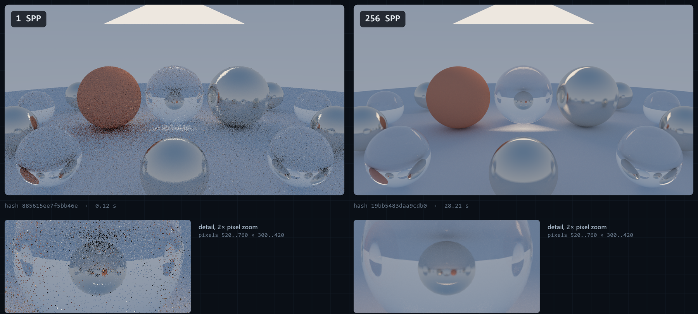

*Figure 2. Two separate Helios renders of the `reflective` scene with the same camera, seed (42), maximum depth (8) and resolution (1280×720), made with the frozen engine; only the number of samples per pixel changed, from 1 (left) to 256 (right). The lower row shows the same pixel region at 2× zoom. Nothing was interpolated or denoised. These are explanatory presentation renders, not performance evidence.*

### 2.2 Bounding volume hierarchies

Testing every ray against every primitive costs time proportional to the primitive count. A bounding volume hierarchy (BVH) groups primitives into nested axis-aligned boxes. A ray that misses a box skips everything inside it, so traversal cost grows roughly with the logarithm of the primitive count for well-built trees [2, Sec. 7.3], [3]. Traversal is a depth-first walk, usually with an explicit stack of nodes still to visit. That stack turned out to matter (Section 5.4).

### 2.3 OpenMP shared-memory parallelism

OpenMP parallelises loops across threads that share one address space. Scheduling clauses decide how iterations are split [4]. Without a chunk size, `static` divides the iterations into roughly equal chunks, at most one per thread. `dynamic` hands out chunks as threads request them, one iteration at a time by default. Shared memory makes result assembly cheap, but it introduces cache effects. When two threads repeatedly write different variables that happen to share a cache line (64 bytes on this processor), the line moves between cores on every write. This is **false sharing** [5]: the program is logically correct but pays a coherence cost.

### 2.4 MPI distributed-memory parallelism

MPI runs separate processes (ranks) that share no memory and exchange explicit messages [6]. Even on one machine this changes the design. Each rank holds its own copy of the scene, results must be sent to a collector, and a scheduler must decide which rank renders what. Blocking send and receive calls are simple and robust. However, a blocking receive waits for a matching message, and a standard-mode send may not complete until a matching receive occurs [6]. Time spent inside these calls therefore includes waiting for the peer, not only data transfer.

### 2.5 Hybrid MPI + OpenMP

Hybrid execution combines the two: MPI distributes work between processes, and OpenMP threads share work inside each process. On clusters of multi-core nodes this matches the hardware, with processes across nodes and threads within a node, and the hybrid model can reduce communication and memory costs [7]. On a single host it mainly tests whether the two layers compose efficiently, since the MPI layer brings no extra memory bandwidth or cores.

### 2.6 Static, dynamic and adaptive scheduling

A **static** schedule fixes the assignment before work starts. It has no runtime coordination cost but cannot react to uneven work. A **dynamic** schedule hands out small pieces as workers become free, so a worker that drew expensive work simply receives fewer pieces. The cost is coordination traffic and a tail effect at the end. An **adaptive** schedule changes the size of each piece at runtime, aiming for large batches while work is plentiful (less traffic) and small batches near the end (a short tail). Shrinking chunks as the remaining work falls is an established idea. OpenMP's `guided` schedule sizes chunks in proportion to the unassigned iterations divided by the thread count [4], and factoring hands out chunks in batches whose size depends on the remaining iterations [8]. Whether such a refinement pays for itself on this host is RQ3.

---

## 3. System Architecture

### 3.1 Rendering pipeline

```text
CLI configuration
  -> deterministic built-in Scene + median-split BVH + Camera
  -> stable row-major microtiles (default 16×16 pixels)
  -> shared render_tile(scene, camera, config, tile, threads)
  -> disjoint 8-bit RGB tile payloads
  -> image assembly -> binary PPM image + JSON telemetry
```

`render_tile` in `src/core.cpp` is the only sampling implementation. Backends differ only in which process or thread calls it for which tile and when. This single design decision underpins the correctness strategy: if the image differs between backends, a backend has a bug, because the arithmetic path per pixel is the same. Figure 3 shows this structure in the code: the shared pipeline in `src/core.cpp` and the seven execution backends in `src/main.cpp` that call `render_tile`.

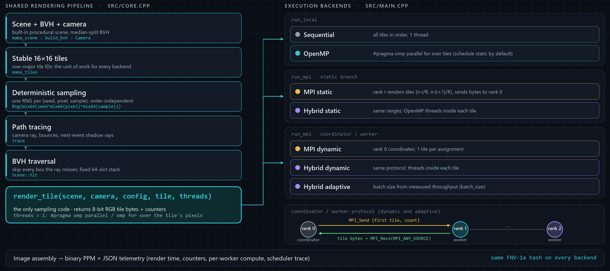

*Figure 3. Helios architecture on the frozen source. The left column is the shared rendering pipeline in `src/core.cpp`, ending in `render_tile`, the only sampling code. The execution backends in `src/main.cpp` (right) differ only in which process or thread calls it for which tile, and when; the dynamic and adaptive backends share the coordinator/worker protocol shown at the bottom right. A diagram of the code structure; it contains no measurements.*

### 3.2 Scene and geometry representation

Scenes are built in code (`make_scene` in `src/core.cpp`). The six built-in scenes share a ground sphere and differ in density and arrangement. Their composition is given in Table 8. The `imbalanced` scene places a 14×14 grid of small spheres in one part of the frame. The `scheduler_stress` scene uses a denser 26×26 grid, so the expensive region is concentrated in part of the image. `uniform` spreads 45 spheres evenly, and `reflective` adds a ring of 12 metal and glass spheres. Materials are diffuse, metal (roughness 0.06), glass (index 1.5) and one emissive triangle light per scene. Figure 4 shows how unevenly the `imbalanced` geometry distributes rendering cost across the tiles.

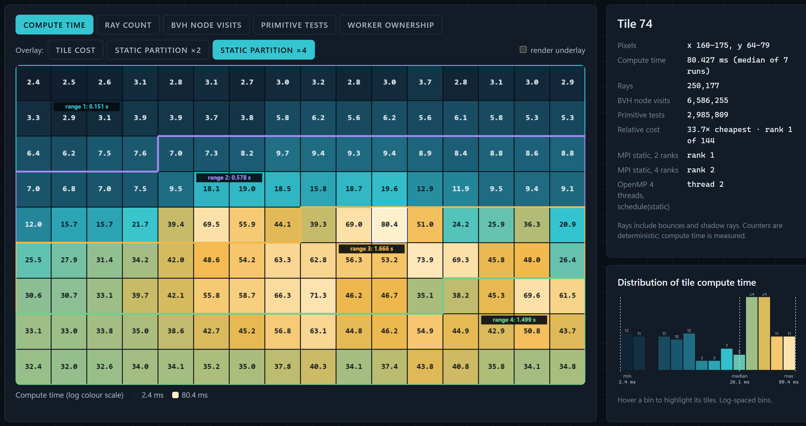

*Figure 4. Compute time of each of the 144 tiles of the `imbalanced` scene at 256×144 and 192 SPP, from the recorded tile telemetry of the final strong-scaling experiment `20260928T102644Z-100e1393` (median of the seven sequential runs; logarithmic colour scale, values in ms). The outlines mark the equal-count four-way static partition, each range labelled with its summed compute time. The side panel gives the recorded counters and the worker ownership of the most expensive tile (74) in the static MPI and OpenMP runs, and the histogram shows the distribution of tile costs. Screenshot of the Helios Observatory Workload Microscope, which reads these values from the tile CSV files.*

### 3.3 Deterministic sampling

Each camera sample creates its own generator: `Rng{mix64(seed ^ mix64(pixel) ^ mix64(sample))}`, where `mix64` is the SplitMix64 finaliser [9] and the generator advances by the SplitMix64 golden-ratio increment. The stream therefore depends only on the global seed, the pixel index and the sample index, never on which thread or rank renders it. Samples within a pixel are accumulated in increasing sample order. Each pixel is written by exactly one worker, and MPI transfers already encoded 8-bit tile bytes, so there is no floating-point reduction whose order could change between runs. The output is summarised by a 64-bit FNV-1a hash of the pixel bytes. The hash is a quick fingerprint, not a cryptographic digest.

### 3.4 BVH acceleration

The BVH builder (`Scene::build_node`) chooses the axis with the widest spread of primitive centroids, splits the primitive list at its median with `std::nth_element`, and stops at leaves of four or fewer primitives. This is simpler than cost-based builders. Goldsmith and Salmon's automatic hierarchy construction already estimated how likely a ray is to hit a box from its surface area [10], and modern builders use the surface area heuristic (SAH) [2, Sec. 7.3]. A count-median split halves the primitive range at every level, so the tree depth is bounded by roughly log2 of the primitive count. The deepest built-in scene tree has depth 8 (511 nodes, in `bvh_stress` and `scheduler_stress`). A brute-force path (`--no-bvh`) tests the same primitive array and is used to validate the BVH.

### 3.5 Tile-based rendering

The image is divided into square microtiles with stable IDs in row-major order. The benchmark resolution of 256×144 with 16-pixel tiles gives 144 tiles. Tiles are the unit of work for every scheduler, which keeps scheduling decisions and message payloads uniform. Because tile IDs are row-major, a contiguous block of IDs covers a horizontal band of the image. That matters for static partitioning when the expensive objects sit in one band.

### 3.6 Execution backend architecture

**Table 1. Execution backends (from `src/main.cpp` and `docs/ARCHITECTURE.md`).**

| Backend | Work distribution | Rank 0 role | Threads inside a tile |
|---|---|---|---|
| `sequential` | All tiles in order | Only process | 1 |
| `openmp` | OpenMP loop over tiles (`schedule(runtime)`, static by default) | Only process | 1 |
| `mpi-static` | Contiguous tile-ID range per rank | Renders its range, then gathers (or only gathers with `--coordinator-only`) | 1 |
| `mpi-dynamic` | One tile per assignment from a coordinator | Coordinates, does not render | 1 |
| `hybrid-static` | Contiguous range per rank | Renders and gathers | `--threads` |
| `hybrid-dynamic` | One tile per assignment | Coordinates | `--threads` |
| `hybrid-adaptive` | Variable batch sized from measured throughput | Coordinates | `--threads` |

The OpenMP backend parallelises *across* tiles: each thread renders whole tiles. The hybrid backends parallelise *inside* a tile: a rank receives a tile and its OpenMP threads split that tile's pixels. This structural difference is where the counter false-sharing defect surfaced (Section 5.3), because only the intra-tile path had several threads writing to adjacent counters. The larger traversal defect (Section 5.4) was in code shared by every backend.

### 3.7 Telemetry and evidence generation

The render clock starts after scene construction, BVH build, camera and tile setup, and stops after image assembly. For MPI this includes a start barrier, all scheduling and result transfer, and a final timing gather. It excludes image and JSON writing. The JSON statistics file records the configuration, render time, image hash, ray, shadow-ray, node-visit and primitive-test counters, and per-worker compute and assignment data. For MPI runs it also records time inside blocking sends and receives, assignment counts, a batch-size histogram, coordinator handling time, a 90%-completion tail and per-worker final completion times. Optional CSV files record every tile's cost and, in trace mode, every dynamic assignment. These files are the raw material for all analysis in this report.

---

## 4. Implementation

### 4.1 Sequential reference renderer

The sequential backend loops over tiles in ID order and calls `render_tile` with one thread. It is the reference for both correctness (its image hash is the expected hash) and performance (the speedup baseline). OpenMP with one thread and MPI with one rank were measured separately. Both are within 0.6% of sequential in the final strong-scaling run (Table 9), so the parallel frameworks add almost no single-worker overhead.

### 4.2 OpenMP backend

`run_local` in `src/main.cpp` distributes tiles with `#pragma omp parallel for schedule(runtime) num_threads(workers)`, where the runtime schedule is set from `--omp-schedule` and defaults to `static`. With the default, each of four threads receives a contiguous quarter of the tile IDs. This makes the OpenMP backend a shared-memory analogue of static MPI partitioning, which is useful for comparison but also means it inherits the same spatial imbalance.

### 4.3 Static MPI backend

`mpi-static` gives rank *r* the tile range `[n·r/R, n·(r+1)/R)`. Ranks render their range, then send a count followed by one header and one pixel payload per tile to rank 0. Rank 0 renders its own range first and then receives. For the scheduler experiments a `--coordinator-only` flag makes rank 0 gather only. All three scheduler policies then use three processes with two rendering ranks, so the comparison has equal rendering capacity.

### 4.4 Dynamic MPI scheduler

In `mpi-dynamic` and the other dynamic modes, rank 0 is a coordinator that never renders. It sends each worker an assignment `{begin, count}` and waits with `MPI_Recv(MPI_ANY_SOURCE)` for any worker to report. It then receives that worker's tiles, places them into the image, updates the worker's throughput estimate and immediately dispatches the next batch to it. A worker renders its batch, sends the count and then each tile, and waits for the next assignment. A zero-count assignment tells a worker to stop. Separate message tags distinguish assignments, batch counts, tile headers and tile pixels. Rank 0 checks that every returned tile ID is valid before placing it. Fixed dynamic scheduling uses a batch of one tile.

### 4.5 Hybrid MPI + OpenMP

The hybrid backends reuse the static or dynamic MPI protocols, but each rank calls `render_tile` with `--threads` threads. Inside `render_tile`, a parallel region splits the tile's pixels among threads with `schedule(static)`. In the final source each thread counts rays and BVH work into a private `Counters` object and merges it into the tile total once, under a named critical section (Section 5.5). Because the split happens inside every tile, a tile's time is set by its slowest pixel band, and the thread team is re-entered for every tile.

### 4.6 Adaptive scheduler

The `hybrid-adaptive` backend changes only the batch-size rule. After a worker returns a batch, the coordinator computes that worker's observed rate (pixels per second of tile render time). The first observation becomes the estimate, and later ones update it as `0.5 × old + 0.5 × latest`. The next batch size is

```text
min( remaining,
     floor( clamp(rate × 0.050 s / tile_area, 1, 8) ),
     max(1, floor(remaining / (2 × workers))),
     8 )
```

The first term aims for about 50 ms of work per assignment. The fairness term shrinks batches as the queue empties, so no worker is left holding a large batch at the end. Before any observation the initial batch is two tiles. The fairness term resembles the decreasing-chunk rules of guided scheduling and factoring [4], [8], but the rate term and cap are this project's own. These defaults (50 ms target, initial batch 2, cap 8, equal-weight update) were fixed before the formal evaluation. An exploratory diagnostic sweep of fixed batch sizes and adaptive targets found no robust improvement. That sweep ran on the pre-fix renderer (`a4d8df8`) with three measured blocks per condition. The defaults were therefore deliberately not tuned on formal data (`docs/ADAPTIVE_POLICY_AUDIT.md`, `docs/FROZEN_EVALUATION_CANDIDATE.md`). The scheduler experiments run this backend with one thread per rank. That isolates the scheduling policy from intra-tile threading, and "adaptive" in Section 7 means this policy on three ranks with one thread each.

### 4.7 Correctness validation infrastructure

A faster backend is only a valid comparison if it does the same work and produces the same answer. Helios checks this at several layers, summarised in Table 2.

**Table 2. Correctness and validation layers.**

| Layer | What it checks | Why it matters |
|---|---|---|
| Core tests (`tests/tests.cpp`) | Vector maths, sphere and triangle intersection, AABB hits and misses, exact-once tile coverage, BVH nearest hit against brute force, repeated seeded renders, OpenMP image equality, BVH on/off image equality | Basic geometric and determinism properties |
| Intra-tile thread test (added in `dca8628`) | Every tile rendered with 1, 2, 3 and 4 intra-tile threads gives identical pixels **and** identical ray, shadow-ray, node, primitive, pixel and tile counts | Guards the hybrid path; it also fails on a deliberately racy shared-counter mutant, so it is not vacuous |
| BVH bound tests (added in `e2c13e2`) | All six scenes fit the fixed traversal stack; a 4096-sphere tree keeps logarithmic depth and matches brute force on 256 rays (148 hits, 108 misses) | Guards the traversal fix, including trees much deeper than the built-in scenes |
| `scripts/validate_cli.py` | 12 invalid command-line cases are rejected | Input handling |
| `scripts/validate_bvh.py` | BVH and brute-force images are identical in all six scenes | The acceleration structure does not change the result |
| `scripts/validate_backends.py` | 11 backend, rank and thread configurations give the same image hash, plus edge cases such as fewer tiles than workers | Cross-backend equivalence |
| `tests/test_benchmark_analysis.py` | 4 analysis unit tests | The statistics code itself |
| Benchmark runner | Every run's image hash is compared with the sequential reference at the same scene and SPP | No timing is accepted for a wrong image |
| `scripts/verify_experiment.py` | Rechecks each experiment's matrix, record count and files, and independently rehashes every local PPM | Independent of the renderer's own hash |

On the final source all of these passed. The six frozen-source formal experiments had 458 images independently rehashed with no mismatch, and the check was repeated with the same result during the final report audit. Strong and weak summary tables were recomputed from raw records and matched exactly. All 86 SVG figures in the repository, including Figure 6, parse as valid XML. The two performance fixes were accepted only after these checks showed identical image hashes, before and after, for all 11 backend configurations and all six scenes.

Figure 5 shows the property these checks enforce on one larger image. It illustrates the result; the evidence is the automated backend validation and the independent rehash of every formal image described above.

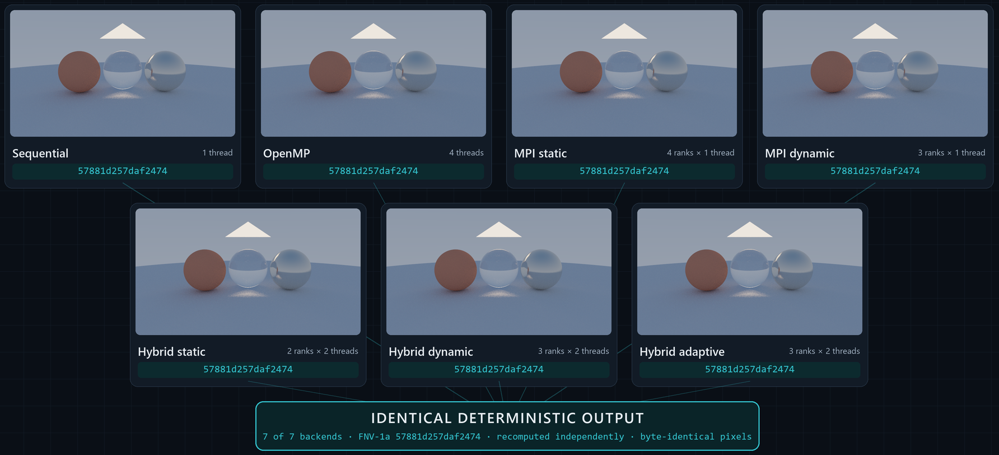

*Figure 5. The `showcase` scene (800×450, 64 SPP, depth 8, seed 42, the configuration of the end-to-end run in Figure 13) rendered by each of the seven backends with the frozen binaries. Every output has the FNV-1a hash `57881d257daf2474`, recomputed independently from the saved image, and the pixel bytes are identical. Rank and thread counts are given on each panel. These are presentation renders, not benchmark runs.*

---

## 5. Performance Engineering Investigation

This section describes how the final performance was reached. It is presented in the order things were learned, including an intermediate conclusion that turned out to be overstated. No sampling profiler was used. The evidence comes from the renderer's own per-tile and per-rank instrumentation, a purpose-built placement observer, address probes and controlled A/B builds. Section 5.1 reports a **historical** formal run. Every other experiment here is **diagnostic**: exploratory, run on pre-fix or intermediate builds, and kept separate from formal evidence. Their directories are listed in Appendix C.

### 5.1 Initial hybrid performance anomaly

The first formal strong-scaling run (`20260928T063038Z-301480e3`, historical, pre-fix source `8d92429`) rendered the medium imbalanced workload in every four-slot configuration. Its results are in Table 3.

**Table 3. Historical four-slot results that started the investigation (pre-fix renderer).**

| Configuration | Median | Paired change vs OpenMP 4 | Paired change vs MPI 4 |
|---|---:|---|---|
| OpenMP 4 threads | 3.208 s | | |
| MPI static 4 ranks | 3.092 s | | |
| Hybrid 4×1 | 3.062 s | | +1.03% (-3.02 to +2.77), 3/7 faster |
| Hybrid 1×4 | 3.634 s | +13.47% (+6.81 to +17.51), 0/7 faster | |
| **Hybrid 2×2** | **4.707 s** | **+43.46% (+39.95 to +51.80), 0/7 faster** | **+51.13% (+49.57 to +55.68), 0/7 faster** |

Hybrid 2×2 was slower than both references in every one of the seven blocks. The easy explanation would have been "hybrid has overhead". Instead the result was treated as a measurement to explain.

The first hypothesis was the partition. In `hybrid-static` 2×2, each rank takes half the tiles, and the dense spheres fall mostly in one half. Summing the sequential run's per-tile costs (6.201 s in total) over each partition gives the best possible time if threads were perfectly efficient. MPI 4 has a heaviest quarter of 2.546 s. Hybrid 2×2 has a heaviest half of 4.941 s, which two perfect threads would finish in 2.47 s. The 2×2 partition is therefore **no worse** than the 4×1 partition, and the hypothesis was rejected.

The per-tile records located the loss. Dividing sequential tile time by the parallel tile time and thread count gives the efficiency of work *inside* a tile. Tiles rendered by one thread in MPI 4 ran at 0.83 of sequential speed, a loss that single-thread tiles also show in every four-worker run (Section 7.2). Tiles split between two threads in hybrid 2×2 reached only 0.52, meaning two threads were barely faster than one. Four threads in 1×4 reached 0.43. The predicted 2×2 time, 4.941 s / (2 × 0.522) = 4.73 s, matched the observed 4.71 s. The problem was inside `render_tile`'s parallel region. MPI transfer was ruled out as well: the heavy rank spent about 1 ms in blocking sends.

### 5.2 Rank and thread placement investigation

The next hypothesis was placement: perhaps the two threads of a rank were sharing one physical core. Microsoft's `mpiexec` offers an `affinity_layout` option whose algorithm and target choose how ranks are placed, with a target of logical core, physical core or NUMA node [11]. A diagnostic study on the pre-fix source (`results/diagnostic/hybrid-v3/20260928T081730Z-e41d9f1c`) compared default launch, affinity disabled, and `spr:p` (spread ranks over physical cores). The first attempts to observe binding were misleading. A PowerShell stand-in launched by `mpiexec` always reported process affinity mask 255 (all CPUs), and its per-thread readout returned nothing, because the .NET property it used is write-only.

A dedicated observer (`scripts/observe_rank_placement.py`) was written to read the live `helios_mpi` processes through Win32 calls. It samples process and thread affinity masks, Windows CPU Sets, per-thread CPU time and per-CPU busy time. Before trusting it, a positive control pinned a child process and thread to known masks and confirmed they were read back correctly. The observer showed the following:

- Under default launch and with affinity disabled, ranks are **unbound**: every mask is 255 and no CPU Sets are assigned.
- Under `spr:p`, Microsoft MPI bound each rank to one physical core through **process default CPU Sets**, applied after start-up. Affinity masks did not show this binding and still read 255. This is consistent with Windows documentation, which describes CPU Sets as a "soft" affinity mechanism, separate from affinity masks, that can be assigned as process defaults [12]. The observation is specific to this host and MS-MPI version. The heavy rank received logical CPUs 0 and 1 (core 0), which were then 95 to 96% busy.
- The CPU Set table gives the machine's real topology: four cores with SMT pairs (0,1), (2,3), (4,5), (6,7).
- At most four Helios threads were active at once on eight logical CPUs, so there was no oversubscription. Idle ranks and the dynamic coordinator used almost no CPU.

The `spr:p` layout made hybrid 2×2 *slower*: 5.158 s against 3.852 s unbound, with per-block ratios of 1.38, 1.31 and 1.34. Binding a two-thread rank to one core puts both threads on SMT siblings. This explained why requested affinity hurt, but not the original slowdown, which had occurred with unbound ranks. Placement was therefore recorded as a real effect that does not account for the anomaly.

### 5.3 Per-thread counter false sharing

Reading `render_tile` gave the next hypothesis. The pre-fix code allocated `std::vector<Counters> local(threads)` for each tile. Thread *t* wrote `local[t]` on every ray, shadow ray, BVH node visit and primitive test, which is hundreds of millions of increments per image. A `Counters` object holds six 64-bit counters, 48 bytes, so neighbouring threads' counters share a 64-byte cache line unless the vector happens to start at an address that is 16 bytes past a line boundary.

A diagnostic build of the pre-fix source printed `local.data() % 64` for every tile (`results/diagnostic/hybrid-v3/false-sharing-20260928T091533Z-068e9dce`). Each rank reused the same offset for all its tiles. In the same binary, the light rank took 1.126 s at offset 16 (no shared line) and 1.47 to 1.52 s at offset 48 (shared line). This is direct evidence of alignment-dependent false sharing.

At this point a padded-counter variant was measured and gave hybrid 1×4 an 18 to 23% improvement. That was initially recorded as the size of the false-sharing penalty. The next step showed this attribution was wrong.

### 5.4 BVH traversal allocation bottleneck

The chosen fix was to make each thread's counters private (Section 5.5). A controlled A/B against the pre-fix source (`results/diagnostic/counter-fix/`) gave hybrid 1×4 only -5.6% to -7.4% in three separate runs. The padded variant, measured in the same sessions, still gave -20.5% and -21.8%. Both variants remove shared counter writes, so the extra gain from padding had to come from somewhere else.

One hypothesis was that the new private counter object, on the master thread's stack, sat next to data other threads read constantly. A variant that aligned it to 64 bytes gave -8.24%, no better. That hypothesis was rejected. The padded variant still made one aligned heap allocation for every tile, whereas the thread-private version made none. That difference pointed at the heap.

`Scene::hit` built a new `std::vector<int> stack{0}` for every BVH query and grew it with `push_back` as the traversal descended. Every counted ray (primary, bounce and shadow) makes one such query, so the medium workload performs about 16.9 million queries per image. Each one performed at least one heap allocation and release, plus reallocations as the vector grew. A diagnostic build that replaced this vector with a fixed array (valid for the benchmark scene only) was tested against the pre-fix source (`counter-fix/20260928T100038Z-b0dae2ec`): OpenMP 4 fell from 3.713 to 2.062 s (-44.3%), hybrid 1×4 from 3.736 to 1.608 s (-57.9%) and hybrid 2×2 from 3.791 to 2.078 s (-45.4%), each faster in 7/7 blocks.

This was the largest inefficiency in the renderer. The earlier 18 to 23% "false sharing" gain had been mostly a heap-layout interaction with this allocation pattern. The documentation was corrected to say so (`docs/HYBRID_TOPOLOGY_AUDIT.md`).

**Table 4. Hypotheses tested during the investigation.**

| Hypothesis | Test | Outcome |
|---|---|---|
| Rank partition causes the 2×2 loss | Ideal critical path from per-tile costs | Rejected: 2.47 s for 2×2 against 2.55 s for 4×1 |
| MPI transfer time | Blocking-send occupancy of heavy rank | Rejected: about 1 ms |
| Unbound threads share a core | Win32 placement observer with positive control | Not the cause; ranks were unbound. Requested `spr:p` binding does cause SMT co-location and is slower |
| Oversubscription | Active-thread count per sampling interval | Rejected: at most 4 active threads on 8 CPUs |
| Counter false sharing | Address probe; thread-private counters | Confirmed but minor: 1×4 -5.6 to -7.4%; strongest on whichever rank has a sharing offset |
| Remaining gap is stack-neighbour false sharing | 64-byte aligned private counter | Rejected: -8.24%, no better |
| Heap allocation in BVH traversal | Fixed-array traversal stack | Confirmed and dominant: -44% to -58% |

### 5.5 Implemented fixes

Two fixes were implemented, each as its own commit. Both preserve every pixel and every counter.

**Counter fix (`dca8628`).** The combined `parallel for` was split into a `parallel` region containing an `omp for schedule(static)`, which gives the same pixel split. Each thread declares `Counters stats` inside the region, accumulates into it, and merges once per tile under `#pragma omp critical(helios_tile_counters)`. There is no shared per-thread array, so there is no layout to get wrong and no allocator alignment to rely on.

**Traversal fix (`e2c13e2`).** `Scene::hit` now uses `int stack[64]` with a top index. A depth-first traversal that pushes both children of each node needs at most depth + 1 slots. `build_bvh` records the tree depth and throws `std::length_error` if a tree would ever need more, so the bound is checked once at build time and not in the hot loop. The count-median split keeps depth logarithmic, and 64 slots cover any primitive count an `int` can index. The built-in scenes need at most 9.

The final A/B (`results/diagnostic/counter-fix/20260928T101701Z-0de80589`) measured three builds in the same randomised session: the pre-fix source `6270d44`, the counter fix alone `dca8628`, and both fixes. It had seven paired blocks per condition, and all 121 runs matched the reference pixel hash and aggregate counters.

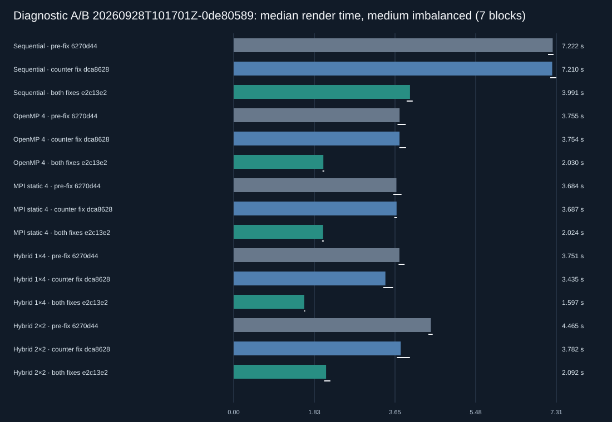

*Figure 6. Median render time of each build in the diagnostic A/B (`results/diagnostic/counter-fix/20260928T101701Z-0de80589`, seven randomised blocks). White lines are 95% bootstrap intervals of each median. The counter fix moves only the two hybrid bars, while adding the traversal fix roughly halves every bar. Paired changes and their intervals are in Table 5. Generated by `scripts/plot_optimisation_ab.py`.*

**Table 5. Optimisation A/B results (paired median change against pre-fix, 95% bootstrap interval, blocks faster out of 7).**

| Condition | Pre-fix median | Counter fix only | Both fixes | Both-fixes median |
|---|---:|---|---|---:|
| Sequential | 7.222 s | +0.05% (-0.88 to +1.56), 3/7 | **-44.62%** (-45.07 to -44.14), 7/7 | 3.991 s |
| OpenMP 4 | 3.755 s | -0.93% (-3.62 to +4.06), 4/7 | **-45.90%** (-46.34 to -45.48), 7/7 | 2.030 s |
| MPI static 4 | 3.684 s | +0.10% (-4.32 to +2.73), 3/7 | **-44.64%** (-47.29 to -44.14), 7/7 | 2.024 s |
| Hybrid 1×4 | 3.751 s | **-8.45%** (-10.54 to -5.05), 7/7 | **-57.50%** (-58.25 to -57.22), 7/7 | 1.597 s |
| Hybrid 2×2 | 4.465 s | **-13.99%** (-17.25 to -13.41), 7/7 | **-53.36%** (-53.69 to -52.47), 7/7 | 2.092 s |

The two fixes have clearly different signatures. The counter fix affects only the paths that thread inside a tile: sequential, OpenMP 4 and MPI 4 are unchanged, with every interval spanning zero. Those serve as negative controls. Because the counter fix did nothing to the sequential path, the whole 44.6% sequential gain belongs to the traversal fix. That gain matches the 45.9% and 44.6% gains of OpenMP 4 and MPI 4. The traversal fix therefore removed a serial per-query cost, not a parallel-contention cost, and it should not be read as a parallelism improvement. The hybrid paths gained 9 to 13 percentage points more than sequential. That margin is of the same order as the counter fix's own effect on them, and it is the only part that looks like a threaded effect.

### 5.6 Frozen performance source

After the traversal fix, the source was frozen at `e2c13e2204ca28aecb90d2d33703587bd16027a1`. Later commits add results, scripts, figures and documentation only. `git diff e2c13e2 HEAD -- src include tests` is empty at every later commit, including the one that adds this report. The rerun manifests therefore record later commit SHAs (`e4a219c` for strong and weak, `6f30f58` for the scheduler experiments) with the same source. All six formal experiments were then rerun on this source with their original parameters and order seeds. The six pre-fix experiments are kept unchanged as historical evidence. Every headline number in Section 7 comes from the reruns. All six rerun manifests record the same Release binaries: `helios.exe` SHA-256 `956685fb…3ef3` and `helios_mpi.exe` `0313fe16a502…`.

---

## 6. Experimental Methodology

### 6.1 Test machine

**Table 6. Measured environment (`docs/ENVIRONMENT.md`, `results/stress/20260928T111419Z-5832e956/environment.json`).**

| Item | Value | How it was obtained |
|---|---|---|
| CPU | 11th Gen Intel Core i7-11370H  3.30 GHz | Processor registry; `Win32_Processor` in the stress manifest |
| Physical cores | 4 | Windows CPU Set table (distinct core indices); `NumberOfCores` in the stress manifest |
| Logical processors | 8 (SMT pairs 0-1, 2-3, 4-5, 6-7) | CPU Set table |
| Cache line | 64 bytes at L1, L2 and L3 (L2 1.25 MiB per core, L3 12 MiB shared) | `GetLogicalProcessorInformation` |
| Memory | 16,843,112,448 bytes (15.69 GiB) | `GlobalMemoryStatusEx` |
| Operating system | Windows NT 10.0.26200 | OS version query |
| Compiler | g++ 14.1.0 (MSYS2 Rev3), `-std=c++20 -O2 -DNDEBUG -fopenmp` | `g++ --version`, `scripts/build.ps1` |
| MPI | Microsoft MPI 10.1.12498.52 via the MSYS2 `mpicxx` wrapper | `mpiexec -help` |
| Analysis | Python 3.11.9 | `python --version` |

No temperature sensor was read, and no CPU isolation or fixed frequency was applied. CMake is not installed on the host. The provided CMake configuration is therefore untested, and all builds used `scripts/build.ps1`.

### 6.2 Benchmark Protocol V2

The first benchmark script (Protocol V1) repeated each backend consecutively, reported a mean-based interval around a median statistic, and counted the MPI coordinator as a rendering slot. An audit of those issues (`docs/BENCHMARKING.md`) led to Protocol V2 (`scripts/benchmark_v2.py`), used for every formal result in this report. V1 results are kept only as historical pilots.

V2 runs the Release binaries serially, one process at a time, with a per-process timeout and an overall budget. Every run's exact command, return code, stdout, stderr, statistics JSON, tile CSV, assignment trace (for dynamic modes) and image are saved in a unique experiment directory. The manifest records the Git SHA, dirty state, executable hashes, source hashes, compiler and host. Since commit `9524144`, a formal run refuses to start if it cannot record the Git SHA. Failed runs stay in the raw evidence and are excluded only from timing statistics. No run was excluded for being slow.

### 6.3 Workload calibration

Workloads hold the image fixed at 256×144 pixels (144 tiles of 16×16), depth 8 and seed 42, and scale the samples per pixel. Holding the image size constant keeps memory and message sizes constant while the compute grows.

**Table 7. Workload presets.**

| Preset | SPP | Camera samples per image | Used by |
|---|---:|---:|---|
| small | 64 | 2,359,296 | scheduler (4 scenes), heterogeneity, weak-scaling baseline |
| medium | 192 | 7,077,888 | strong scaling, scheduler (4 scenes) |
| large | 512 | 18,874,368 | scheduler holdout (`reflective`) |
| stress | 2048 at 1280×720 | 1,887,436,800 | supervised stress test only |

**Table 8. Built-in scenes (`make_scene` in `src/core.cpp`).**

| Scene | Content beyond the ground sphere and one triangle light |
|---|---|
| `showcase` | Three large spheres (diffuse, glass, metal) |
| `uniform` | 45 spheres in an even 9×5 grid |
| `reflective` | Three large spheres and a ring of 12 metal and glass spheres |
| `imbalanced` | As `reflective`, plus a 14×14 grid of small spheres concentrated in one part of the frame |
| `scheduler_stress` | As `reflective`, plus a denser 26×26 grid of smaller spheres |
| `bvh_stress` | Three large spheres plus a 30×30 grid of small spheres |

The presets were sized with bounded sequential probes (`results/calibration/20260928T061836Z-d9ba2353`). Those probes ran on the **pre-fix** renderer and measured 2.307 s, 6.146 s and 16.645 s for imbalanced small, medium and large. They define the workloads but are not final timings. On the frozen source, sequential medians ranged from 0.595 s (small uniform) to 1.506 s (small stress), from 1.707 s to 4.518 s at medium (3.933 s for medium imbalanced in the strong-scaling run), and 8.396 s for large reflective. Together these are three clearly increasing workloads, plus the much larger stress workload.

### 6.4 Warm-up and repeated runs

Each condition receives one warm-up run, which is excluded from statistics, followed by seven measured runs. The warm-up absorbs first-run effects such as page faults, file-system caching of the binary and MPI start-up paths. Seven runs are enough for the bootstrap intervals described below while keeping each experiment within a few minutes on the laptop.

### 6.5 Randomised block ordering

Measured runs are organised in blocks. Each block renders every condition once, in an order shuffled from a recorded seed plus the block number. Running conditions in a fixed order would let slow drift in the machine, from background activity, clock changes or heat, fall systematically on whichever condition runs last. Shuffling spreads that drift across conditions, and the recorded seed makes the order reproducible. It does not make the machine state reproducible. The frozen-source reruns reused the original order seeds, so each rerun executed its conditions in the same order as its historical counterpart.

### 6.6 Statistical analysis

The primary statistic is the median render time, which is robust to an occasional slow run. Mean, sample standard deviation, minimum and maximum are reported alongside it in the aggregate CSV files. Each median has a 95% percentile bootstrap interval [13], [14] computed from 4,000 deterministic resamples.

Comparisons between two conditions use **paired** statistics. Because both conditions ran in the same block, their ratio in that block cancels drift common to the block. The analysis takes the median over blocks of `candidate / reference - 1` and bootstraps an interval for that median. It reports the same for the absolute difference in seconds, and counts in how many blocks the candidate was faster.

These intervals are read conservatively, for four reasons:

- An interval that contains zero means **no difference was resolved**. It is not evidence that the conditions are equal, because the protocol includes no equivalence test.
- With seven blocks, a bootstrap median is always one of the seven observed values, so the interval endpoints are observed block values and the intervals are coarse.
- Runs on one machine may be serially correlated, which the bootstrap does not model.
- No correction is made for multiple comparisons. If ten independent intervals with nominal 95% coverage compared truly equal conditions, the chance that at least one would exclude zero is about 40%.

For these reasons, an effect is treated as resolved only when its interval excludes zero **and** most blocks agree in direction. A general claim about a policy additionally requires the same direction across scenes.

**Speedup and efficiency.** With `T_1` the sequential median and `T_p` the median of a condition using `p` rendering slots,

```text
S_p = T_1 / T_p          (speedup)
E_p = S_p / p            (parallel efficiency)
```

`T_1` is always the sequential backend, not a one-thread run of the parallel backend. `p` counts the threads or processes that execute `render_tile`:

- **OpenMP:** `p` is the number of threads.
- **Static MPI:** `p` is the number of ranks, since every rank renders. With `--coordinator-only`, as in the scheduler experiments, rank 0 only gathers, so `p` is the number of ranks minus one.
- **Dynamic and adaptive MPI and hybrid modes:** `p` is the number of worker ranks × threads per rank. The coordinator never renders, so a dynamic run with `p = 2` launches three processes.
- **Hybrid static:** `p` is ranks × threads.
- **SMT:** `p` counts logical processors. OpenMP with 8 threads therefore has `p = 8` on 4 physical cores, and `E_8` is efficiency per logical processor. Efficiency per physical core would be `S_8 / 4`.

On this definition, `E_p = 1` is linear speedup. Fixed-size speedup is bounded by the fraction of work that cannot be parallelised, Amdahl's argument [15]. Section 7.2 shows that, for this workload, the binding limit was load imbalance rather than serial code.

Compute imbalance is `max worker compute time / mean worker compute time - 1` over rendering workers, so zero means equal accumulated compute.

### 6.7 Correctness verification

Every run's image hash is compared with a sequential render of the same scene and SPP, and weak-scaling runs are checked against separate same-SPP references. After each experiment, `verify_experiment.py` checks the run matrix and independently rehashes every saved image. The frozen-source experiments passed with 458 of 458 images matching (Section 4.7).

### 6.8 Strong scaling

Strong scaling holds the medium imbalanced workload fixed and varies the parallel resources. The matrix covers sequential; OpenMP with 1, 2, 4 and 8 threads; static MPI with 1, 2 and 4 ranks; and hybrid static with 1×4, 2×2 and 4×1 ranks × threads. That is 11 conditions and 88 runs. OpenMP 8 uses SMT logical processors and is labelled separately from the four-slot comparisons.

### 6.9 Weak scaling

Single-host weak scaling raises SPP in proportion to rendering slots: 64 SPP for one slot, 128 for two and 256 for four, with the image fixed. This follows Gustafson's scaled-problem view, in which problem size grows with the number of processors [16]. With `W` the one-slot workload, weak efficiency is

```text
E_weak(p) = T_1(W) / T_p(p·W)
```

using the sequential median at 64 SPP for `T_1(W)`. A value of 1.0 would mean that `p` slots absorb `p` times the work in the same time. On one laptop this measures how well extra cores absorb extra work. It does not measure cluster scalability.

### 6.10 Scheduler ablation

The scheduler experiments compare four conditions per scene: sequential, static coordinator-only, fixed one-tile dynamic, and adaptive. All three MPI policies use three processes, two rendering ranks and one thread per rank, so they have identical rendering capacity. They were run on all four natural scenes at the small and medium presets, and on `reflective` at the large preset as a holdout whose SPP was never used for any tuning.

### 6.11 Synthetic heterogeneous-worker experiment

To test scheduling under unequal workers, rank 1 is slowed with `--slow-factor-milli 2000`. After each tile it busy-waits for as long as the tile took to render, so its effective speed is halved. The delay is measured and recorded separately (`stall_seconds`) and excluded from compute time. This is a synthetic treatment on one host, since the busy-wait uses a CPU core. It is labelled as such and not presented as a natural-scene result.

---

## 7. Results

All results in this section are from the frozen source `e2c13e2`. Figures 7 to 12 are generated directly from the saved aggregates (Appendix C).

### 7.1 Renderer optimisation

Table 5 and Figure 6 (Section 5.5) are the controlled measurement of the two fixes and are not repeated here. One consequence matters for reading the results below. The traversal fix sped up the sequential baseline by about as much as OpenMP and MPI, so their speedups relative to sequential changed little between the historical and final runs. OpenMP 4, for example, went from 1.96× to 1.93×. The exceptions are hybrid 1×4 (1.73× to 2.45×) and hybrid 2×2 (1.33× to 1.91×), whose historical penalty came largely from the defects. Historical and final runs are separate sessions, not paired, so these before-and-after figures show a change of pattern and are not effect sizes.

### 7.2 Strong scaling

**Table 9. Final strong scaling, medium imbalanced (`20260928T102644Z-100e1393`, 88/88 runs, 7 measured blocks).**

| Execution | Rendering slots `p` | Median (95% bootstrap interval) | Speedup `S_p` | Efficiency `E_p` |
|---|---:|---|---:|---:|
| Sequential | 1 | 3.933 s (3.886 to 4.106) | 1.00× | 1.00 |
| OpenMP 1 thread | 1 | 3.923 s (3.888 to 4.093) | 1.00× | 1.00 |
| OpenMP 2 threads | 2 | 3.304 s (3.292 to 3.341) | 1.19× | 0.60 |
| OpenMP 4 threads | 4 | 2.041 s (2.008 to 2.164) | 1.93× | 0.48 |
| OpenMP 8 logical threads | 8 | 1.323 s (1.300 to 1.381) | 2.97× | 0.37 |
| MPI static 1 rank | 1 | 3.910 s (3.905 to 3.937) | 1.01× | 1.01 |
| MPI static 2 ranks | 2 | 3.304 s (3.287 to 3.318) | 1.19× | 0.60 |
| MPI static 4 ranks | 4 | 2.020 s (2.001 to 2.074) | 1.95× | 0.49 |
| Hybrid static 1×4 | 4 | 1.603 s (1.583 to 1.676) | 2.45× | 0.61 |
| Hybrid static 2×2 | 4 | 2.057 s (2.048 to 2.121) | 1.91× | 0.48 |
| Hybrid static 4×1 | 4 | 2.035 s (2.029 to 2.085) | 1.93× | 0.48 |

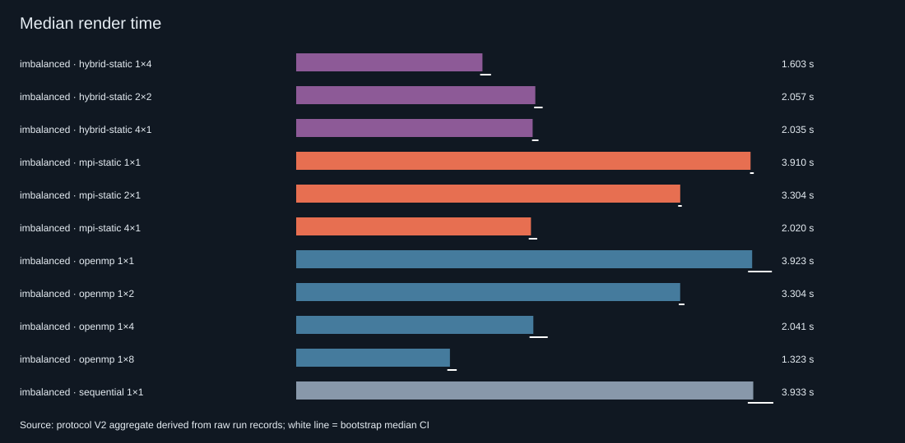

*Figure 7. Median render time for all 11 strong-scaling conditions on the frozen source (`20260928T102644Z-100e1393`).*

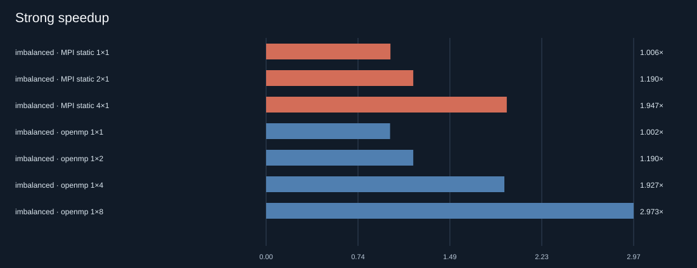

*Figure 8. Strong speedup relative to the sequential median.*

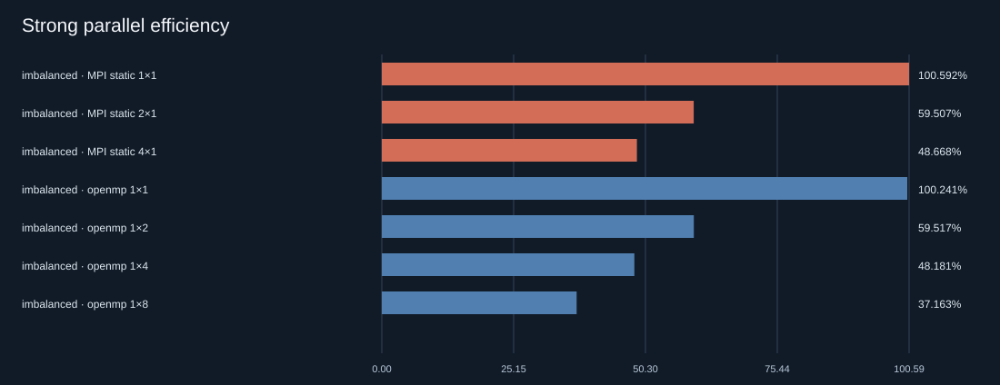

*Figure 9. Parallel efficiency per rendering slot. OpenMP 8 counts eight logical processors on four physical cores.*

The striking feature is how low the efficiencies are for the simple static decompositions: 0.60 at two slots and 0.48 to 0.49 at four. The per-tile data show that most of this loss is set by the workload's spatial imbalance, not by the frameworks.

Serial code outside the tiles is not the limit. In the seven sequential runs, `render_tile` accounts for all but 0.01% of the measured render time, so Amdahl's serial fraction [15] is negligible here. On the frozen source, the per-tile median costs sum to 3.894 s. OpenMP static, static MPI and hybrid static all split the tile IDs into equal-count contiguous ranges. For that partition, the heaviest half costs 3.165 s and the heaviest quarter 1.666 s. Even with perfectly efficient workers, the two-way partition can therefore reach at most 1.23× and the four-way partition at most 2.34×. A cost-aware contiguous split could do better, but none of these backends uses one.

The observed 1.19× and 1.93× to 1.95× sit below those caps. At four slots, single-thread tiles ran at about 0.80 of their sequential speed (sum of sequential tile time divided by sum of parallel tile time). Shared caches, memory bandwidth and frequency behaviour are plausible causes, but none was isolated. The compute imbalance of the static layouts agrees with the caps. It is 0.58 for the two-way partitions, 0.65 for the four-way ones and 0.56 for hybrid 2×2, which partitions two ways. The busiest worker therefore did 56% to 65% more compute than the average. This is the problem dynamic scheduling addresses in Section 7.4.

**Table 10. Final paired strong-scaling comparisons (`strong_paired.md` in the same experiment).**

| Candidate vs reference | Candidate faster | Median paired change (95% CI) | Median absolute difference |
|---|---:|---|---:|
| Hybrid 2×2 vs OpenMP 4 | 4/7 | -0.30% (-2.02 to +3.29) | -0.006 s |
| Hybrid 2×2 vs MPI 4 | 2/7 | +1.84% (-0.19 to +4.02) | +0.037 s |
| Hybrid 1×4 vs OpenMP 4 | 7/7 | -20.66% (-25.95 to -18.80) | -0.415 s |
| Hybrid 4×1 vs MPI 4 | 0/7 | +1.01% (+0.54 to +1.96) | +0.022 s |
| OpenMP 4 vs MPI 4 | 2/7 | +0.34% (-1.40 to +8.15) | +0.007 s |
| OpenMP 8 vs OpenMP 4 | 7/7 | -34.69% (-39.92 to -32.31) | -0.699 s |
| Hybrid 1×4 vs hybrid 2×2 | 7/7 | -22.47% (-24.42 to -18.67) | -0.462 s |

### 7.3 Weak scaling

**Table 11. Final single-host weak scaling, small imbalanced (`20260928T103116Z-c00a63fc`, 50/50 records).**

| Condition | SPP | Median | Weak efficiency | Historical (pre-fix) |
|---|---:|---:|---:|---:|
| Sequential (baseline) | 64 | 1.346 s | 1.00 | 1.00 |
| OpenMP 2 | 128 | 2.223 s | 0.61 | 0.60 |
| MPI static 2 | 128 | 2.199 s | 0.61 | 0.61 |
| OpenMP 4 | 256 | 2.740 s | 0.49 | 0.49 |
| MPI static 4 | 256 | 2.725 s | 0.49 | 0.52 |
| Hybrid 2×2 | 256 | 2.778 s | 0.48 | 0.33 |

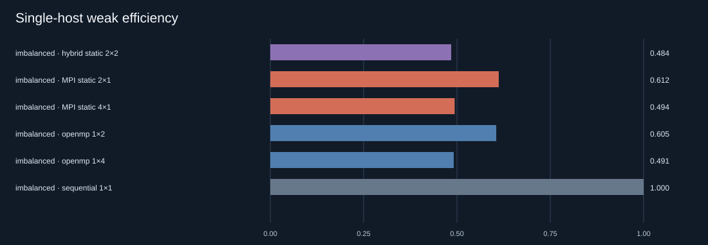

*Figure 10. Single-host weak efficiency on the frozen source (`20260928T103116Z-c00a63fc`).*

Weak efficiencies of about 0.6 at two slots and 0.5 at four are close to the strong-scaling efficiencies. That is expected. The same equal-count partitions are used, and the spatial distribution of cost comes from the scene geometry. Raising SPP multiplies every tile's cost without moving the expensive band. These values therefore mostly measure the same imbalance again, not a separate limit on absorbing more work. A dynamically scheduled weak-scaling run was not part of the formal matrix.

The historical column comes from a separate, unpaired session and is shown for one point only. OpenMP and MPI weak efficiencies stayed within about 0.03 of their pre-fix values. That is consistent with the traversal fix speeding these conditions by similar factors (Table 5). Hybrid 2×2 rose from 0.33 to 0.48 and now sits with the other four-slot layouts.

### 7.4 Static vs dynamic scheduling

**Table 12. Final scheduler results (paired median change and 95% bootstrap interval, 7 blocks; assignment counts are medians; 3 ranks with 2 rendering ranks and 1 thread each).**

| Experiment / scene | Fixed dynamic vs static | Adaptive vs static | Adaptive vs fixed dynamic | Assignments, adaptive / fixed |
|---|---|---|---|---|
| medium imbalanced | -31.84% (-35.27, -29.23) | -32.18% (-33.96, -30.93) | -0.64% (-2.59, +3.84) | 73 / 144 |
| medium reflective | -27.52% (-29.71, -26.09) | -27.80% (-30.08, -26.05) | +0.18% (-3.93, +0.67) | 69 / 144 |
| medium scheduler_stress | -30.42% (-31.33, -29.48) | -31.68% (-32.57, -29.56) | -0.68% (-2.82, +1.24) | 79 / 144 |
| medium uniform | -27.76% (-29.57, -25.22) | -28.86% (-29.86, -26.68) | **-2.73% (-4.22, -1.60)** | 36 / 144 |
| large reflective (holdout) | -28.42% (-28.79, -26.83) | -26.89% (-27.48, -25.71) | **+1.83% (+0.15, +2.37)** | 100 / 144 |
| small imbalanced | -31.27% (-34.21, -27.02) | -32.49% (-34.62, -31.64) | -1.39% (-6.34, +2.61) | 31 / 144 |
| small reflective | -28.18% (-30.69, -25.65) | -30.33% (-31.95, -27.94) | +0.30% (-3.50, +0.52) | 29 / 144 |
| small scheduler_stress | -29.03% (-31.96, -27.22) | -30.12% (-33.52, -24.23) | +2.69% (-2.54, +9.00) | 35 / 144 |
| small uniform | -27.79% (-31.60, -27.18) | -29.43% (-30.15, -28.65) | -1.18% (-5.38, +1.58) | 28 / 144 |
| heterogeneity, rank 1 slowed 2× | -12.06% (-15.71, -6.87) | -11.71% (-13.17, -6.93) | -0.06% (-3.70, +3.42) | 40 / 144 |

Sources: medium `20260928T103934Z-edc10839`, large `20260928T104502Z-5e829d04`, small `20260928T104823Z-8e1c1ed4`, heterogeneity `20260928T105023Z-1dd576e1`.

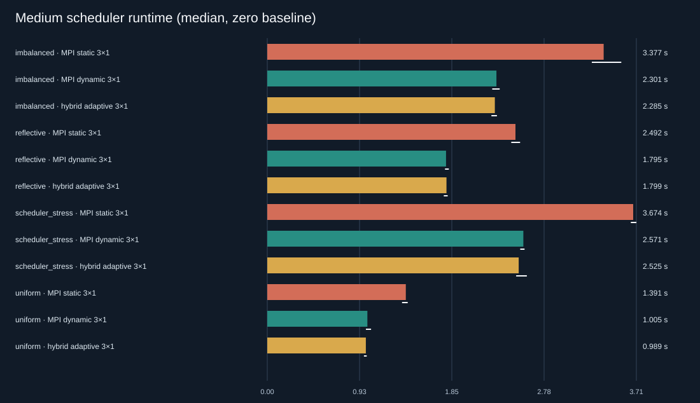

*Figure 11. Median runtime of static coordinator-only, fixed dynamic and adaptive scheduling on the four medium scenes (`20260928T103934Z-edc10839`).*

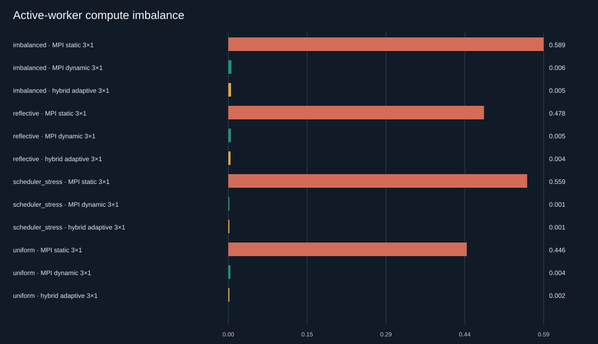

*Figure 12. Compute imbalance between the two rendering workers. Static partitions leave one worker with 45% to 59% more compute than the average; both dynamic modes stay below 0.6%.*

Dynamic scheduling beat static partitioning in all nine natural-scene cases, by 27.5% to 31.8%, and every interval excludes zero. The mechanism is visible in the telemetry. On natural scenes both workers received about 72 of 144 tiles under either policy, so dynamic scheduling did not move more tiles to one worker. Instead it *interleaved* expensive and cheap tiles, so each worker's mix of work evened out. Compute imbalance fell from 0.45 to 0.59 under static to at most 0.006 under dynamic scheduling. On the medium scenes, with two rendering ranks, the dynamic policies reached 1.69× to 1.79× over sequential (0.85 to 0.90 per rendering slot), against 1.15× to 1.26× for static. That approaches the two-slot ideal of 2×, despite the coordinator protocol's blocking round trips.

### 7.5 Adaptive vs fixed dynamic scheduling

Adaptive batching achieved its design aim of coarser granularity without losing balance. It used 28 to 100 assignments instead of 144, and its compute imbalance stayed as low as fixed dynamic's. On wall-clock time, however, it showed **no consistent direction**. Eight of the ten intervals contain zero. The two that exclude zero point in opposite directions. Medium uniform favoured adaptive by 2.73% (about 0.03 s, adaptive faster in 6 of 7 blocks). The large reflective holdout favoured fixed dynamic by 1.83% (about 0.09 s, adaptive faster in 1 of 7 blocks). Each may be a real effect of 3% or less specific to its scene and preset. However, the two disagree in direction, and with ten uncorrected comparisons chance cannot be excluded (Section 6.6). In the separate, unpaired historical pre-fix run, medium uniform had leaned the other way (+1.66% for adaptive). The evidence therefore supports no stable advantage in either direction.

The telemetry explains why the saving was small. Fewer assignments means fewer round trips. However, the medium runs' summed worker assignment-wait time was only about 0.01 s under fixed dynamic and about 0.003 to 0.007 s under adaptive, on renders lasting 1 to 4.5 s. On one host, blocking MPI messages are cheap, so a one-tile schedule leaves little coordination cost to remove. The few milliseconds adaptive could save are smaller than the run-to-run standard deviations of the medium dynamic conditions, 0.02 to 0.09 s.

### 7.6 Hybrid configurations

With the defects fixed, the three four-slot hybrid layouts behave as their structure predicts. Hybrid 4×1 is MPI 4 with the hybrid code path. It converges on MPI 4 but carries a small cost of +1.01% (+0.54 to +1.96%, 0 of 7 blocks faster), about 22 ms, whose interval excludes zero. Its cause was not isolated.

Hybrid 2×2 no longer differs resolvably from OpenMP 4 (-0.30%, -2.02 to +3.29) or MPI 4 (+1.84%, -0.19 to +4.02). The MPI interval only just contains zero, so a small penalty cannot be ruled out. Splitting a tile between two threads now reaches a per-tile efficiency of 0.74, up from 0.52 in the historical run and a little below the 0.80 of single-thread tiles. The remaining gap is consistent with re-entering the thread team for every tile and with pixel bands of unequal cost, but its cause was not isolated. In a pre-fix diagnostic, a pixel-level `schedule(dynamic,16)` inside tiles changed 2×2 very little (3.726 s against 3.755 s), which suggests that uneven pixel bands are a minor factor.

Hybrid 1×4 is the fastest four-slot layout: 20.7% faster than OpenMP 4 in every block, and a 2.45× speedup that exceeds the 2.34× cap on the equal-count four-way tile partition. It can exceed that cap because it never partitions the tile list at all. Every tile is split four ways, so the tile-level imbalance that limits OpenMP 4 and MPI 4 does not arise. What remains are imbalance between pixel bands inside each tile and the per-tile thread-team cost, and 1×4's per-tile efficiency is 0.61. This is a decomposition effect, not evidence that hybrid execution is intrinsically faster. OpenMP with `schedule(dynamic)` over tiles would not be bound by the partition cap either, but it was not part of the formal strong-scaling matrix.

### 7.7 SMT behaviour

OpenMP with eight logical threads on four physical cores ran in 1.323 s against 2.041 s for four threads: 34.69% faster, in all seven blocks (interval -39.92% to -32.31%). Its efficiency per logical slot, 0.37, is the lowest in the table. Both statements are true at once. Simultaneous multithreading lets several threads issue instructions to one core's functional units in the same cycle [17], so a second thread can use execution resources the first leaves idle. Why this workload benefits, for example through memory stalls during irregular BVH traversal, was not measured here. The second hardware thread is not a second core, so doubling the thread count does not double the compute available. This result shows why efficiency must be read with the resource definition in mind: counting eight logical processors as eight slots understates what the hardware delivers per physical core.

### 7.8 Synthetic worker heterogeneity

With rank 1 slowed to half speed, both dynamic policies shifted work away from it. The slowed rank received 47 (fixed dynamic) or 52 (adaptive) of 144 tiles, against static's fixed 72. Their compute-plus-delay imbalance was 0.004 to 0.010, against 0.28 for static. Their compute-only imbalance of 0.32 to 0.34 is expected here, since the dynamic policies deliberately gave the slowed rank less compute. Dynamic scheduling was 12.06% faster than static, and adaptive showed no resolved difference from fixed dynamic (-0.06%, -3.70 to +3.42). The gain over static is smaller than on natural scenes. The busy-waiting rank also consumes a core, and in this scene the static partition happened to give the slowed rank the cheaper half of the image, which partly offset the injected delay.

---

## 8. Stress Test

### 8.1 Stress workload

The task requires a workload that fails, does not finish, or must be terminated. The stress workload (`docs/STRESS_TEST_PLAN.md`) is a sequential render of `scheduler_stress` at 1280×720, 2048 SPP, depth 16, tile 16 and seed 42. That is 921,600 pixels and 1,887,436,800 camera samples, each allowed up to 16 bounces, on one thread. It uses the same scene and depth as bounded calibration probes, but with 25 times the pixels and 4 times the largest probe's samples. Its image buffer is only about 2.8 MB, so it tests sustained computation rather than memory exhaustion.

### 8.2 Procedure

The run used a gated evidence script, `scripts/run_supervised_stress.ps1`, which refuses to start without an explicit `-IUnderstandThisIsLong` switch. It records the exact command, Git SHA, executable hash, host details and UTC start and end times. It captures stdout and stderr to files and applies a configurable timeout. At the timeout it kills the whole process tree, and it writes a manifest in all cases. The official run was performed once, on the frozen binary, with the user present:

```powershell
./scripts/run_supervised_stress.ps1 -IUnderstandThisIsLong -TimeoutSeconds 600
```

### 8.3 DNF result

**Table 13. Stress-test evidence (`results/stress/20260928T111419Z-5832e956/`).**

| Item | Recorded value |
|---|---|
| Child command | `helios.exe render --backend sequential --scene scheduler_stress --width 1280 --height 720 --spp 2048 --max-depth 16 --tile 16 --seed 42 --output …\stress.ppm --stats-json …\stress.json` |
| Start / end (UTC) | 2026-09-28T11:14:21.0885Z / 2026-09-28T11:24:21.4335Z |
| Elapsed wall time | 600.34 s (timestamps and stopwatch agree within 5 ms) |
| Timeout | 600 s |
| Outcome | `timed_out: true`. The process tree was terminated and no Helios process remained. The exit code is null because the process was killed. |
| stdout / stderr | Both empty |
| Output files | None: no PPM or statistics JSON |
| Source / binary | HEAD `836238077ba5`, source identical to `e2c13e2`; executable SHA-256 `956685fb…3ef3` |
| Host | Table 6 (manifest plus `environment.json`) |

**Outcome: DNF. The run was intentionally terminated after 10 minutes because the configured stress workload had not completed.**

### 8.4 Interpretation

The render did not finish within the ten-minute waiting period. It did not crash: nothing was written to stderr and the process ran until it was killed. Memory use was not recorded, but nothing suggests memory exhaustion, and the image buffer is only about 2.8 MB. How far it got is unknown, because Helios prints no progress while rendering and writes its image and statistics only after the whole render completes. The computational demand simply exceeded the practical waiting period on this host. The original completion estimate (about 33 minutes) came from pre-fix probes, and a rough rescaling for the faster frozen renderer suggests around 18 minutes. Neither estimate is a measurement, since the full workload was never run to completion. Adding periodic progress output or checkpointing would make such runs more informative (Section 13).

---

## 9. End-to-End Demonstration Evidence

Figure 1 (Section 1.2) shows the kind of image Helios produces, and Figure 5 (Section 4.7) shows the image of this configuration from all seven backends. Figure 13 is a real screenshot of a complete run through the most complex backend, captured manually by the user in a visible PowerShell window.

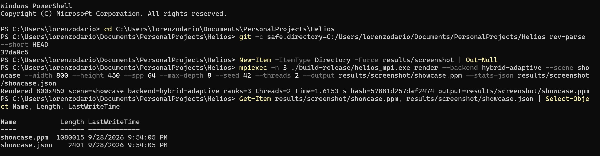

*Figure 13. Successful end-to-end run on the frozen build: `mpiexec -n 3 ./build-release/helios_mpi.exe render --backend hybrid-adaptive --scene showcase --width 800 --height 450 --spp 64 --max-depth 8 --seed 42 --threads 2 …`. The terminal shows the repository path, the Git revision (`37da0c5`), the full command, the completion line `Rendered 800x450 scene=showcase backend=hybrid-adaptive ranks=3 threads=2 time=1.6153 s hash=57881d257daf2474`, and the two output files with sizes and timestamps.*

The screenshot demonstrates that the program builds and runs end to end with MPI and OpenMP together. It shows one coordinator and two worker ranks, each using two threads, the measured render time, and the deterministic image hash. The run's statistics file (`results/screenshot/showcase.json`) records the same configuration, 1.6153331 s and hash `57881d257daf2474`, and 54,402,020 rays. The saved image independently rehashes to the same value. Its size, 1,080,015 bytes, is exactly an 800×450 PPM with its header.

---

## 10. Discussion

### 10.1 Main performance findings

Section 7 gives the numbers; three points stand out. First, on this four-core laptop the limiting factor for static decompositions was the workload's spatial imbalance, not the choice of OpenMP, MPI or hybrid: all three reached about the same speedup under the same partition. Second, decompositions that escaped the fixed tile partition achieved higher efficiency per slot, whether by splitting inside tiles (hybrid 1×4, 0.61 against 0.48) or by handing out tiles dynamically (0.85 to 0.90 against 0.58 to 0.63 at two slots). Third, the single largest improvement did not come from parallelism at all. It came from removing a per-query heap allocation, which made the sequential, OpenMP 4 and MPI 4 configurations about 45% faster in the controlled A/B.

### 10.2 Why dynamic scheduling helped

The imbalanced scenes concentrate cost in one band of the image. A static contiguous split hands that band to one worker, and the other finishes early and idles. Dynamic one-tile assignment lets both workers draw from the whole image. When the queue empties, neither worker can be left with much more than one tile of extra work, so the remaining imbalance is bounded by roughly one tile's cost. The coordination this needs cost only 6 to 11 ms of summed worker waiting per render (Section 7.5). Fine-grained dynamic scheduling therefore recovered most of the time static partitioning lost. That answers RQ2 for these workloads on this host. Figure 14 replays one run of each policy on the medium `imbalanced` scene from the recorded evidence.

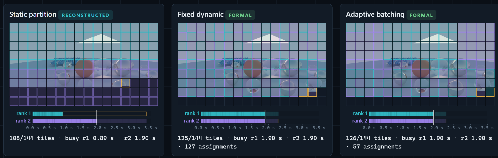

*Figure 14. Static, fixed dynamic and adaptive scheduling of the medium `imbalanced` workload (two rendering ranks, rank 0 coordinating), each 1.9 s into the median-time run of its policy in the formal experiment `20260928T103934Z-edc10839`. The runs are separate executions aligned by elapsed time from the start of rendering, not simultaneous. Tiles are coloured by the rank that rendered them (cyan rank 1, purple rank 2, dark not yet rendered); the bars show each rank's tile compute intervals on a 0 to 3.5 s axis, bright up to the current time, with idle time outlined in amber. Fixed dynamic and adaptive are replayed from the recorded dispatch trace and tile telemetry. Screenshot of the Helios Observatory Scheduler Lab.*


### 10.3 Why adaptive scheduling did not consistently win

Adaptive batching targets the traffic cost of fine-grained scheduling, and on one host that cost was nearly absent. The few milliseconds of waiting it saved were smaller than run-to-run variation (Section 7.5). An exploratory diagnostic suggests the other side of the trade-off. It ran on the pre-fix renderer with three measured blocks per condition (`results/diagnostic/adaptive-v3/20260928T074207Z-555c6e66`, medium imbalanced). Fixed batches of eight tiles cut assignments from 144 to 18, but widened the spread of final-worker completion times from 0.013 to 0.461 s, and the median wall time rose from 3.177 to 3.501 s. This small pre-fix sample illustrates the tail risk of coarse batches and is not a formal result.

The answer to RQ3, within its single-host scope, is: yes for coordination cost, no for wall-clock time. Adaptive batching preserved balance and reduced assignments and waiting, but it gave no consistent wall-clock advantage over fixed one-tile scheduling. Adaptive batching could plausibly matter where each message is expensive, such as over a real network, or where tiles are very small. This project did not test either case.

### 10.4 Hybrid execution trade-offs

The hybrid results show that hybrid performance depends on *where* each layer splits the work. Splitting inside tiles (1×4) avoids tile-level spatial imbalance but pays a thread-team cost on every tile. Splitting by rank (4×1) avoids that cost but inherits the imbalance. Hybrid 2×2 sits between them and, on this host, matched OpenMP 4 and MPI 4 within the resolution of the experiment.

On a single machine the MPI layer brings no extra hardware, so hybrid execution cannot win by using resources the other models lack. It can only win by decomposing the work better, as 1×4 did. It also has more ways to go wrong. The historical, pre-fix 43% penalty arose on the intra-tile threaded path that the simpler backends do not exercise, and the fixes removed the hybrid-specific gap measured in the controlled A/B (Section 5.5). The larger historical gap was never reproduced, so its full size was not attributed (Section 11). Requested affinity added a further trap. On this host, Microsoft MPI's `spr:p` layout bound a two-thread rank to one physical core through CPU Sets that ordinary affinity masks do not show.

### 10.5 Algorithmic vs parallel optimisation

The BVH traversal fix improved the sequential renderer by 44.6%, and OpenMP 4 and MPI 4 by similar proportions. That is larger than any scheduling change measured in this project: dynamic against static scheduling gave 27.5% to 31.8%. It is a useful reminder that parallel speedup multiplies whatever the serial code does. In the same A/B session, pre-fix OpenMP 4 (3.755 s) was barely faster than the fixed sequential renderer (3.991 s). Measuring the sequential baseline carefully, and fixing it, changed absolute performance far more than any scheduling refinement. The counter false-sharing fix is the opposite kind of example: a purely parallel defect, invisible to sequential and to tile-level OpenMP, found only because the hybrid numbers looked wrong.

### 10.6 Scalability limits

Three limits bound what the results can show. First, the machine has four physical cores, so four-slot configurations are the true scaling limit and eight threads measure SMT. Second, the imbalanced scene caps the equal-count four-way tile partition at 2.34×, so those static configurations would not approach linear scaling even on perfect hardware. Third, the dynamic modes spend one of three processes on coordination, so only two ranks render. None of these is a defect of the implementation. They are properties of the workload and platform that the analysis quantifies rather than hides.

---

## 11. Threats to Validity

**One machine.** Every measurement comes from one laptop with four physical cores and SMT. Results may differ on machines with more cores, different cache sizes or a different SMT implementation, and nothing here demonstrates cluster behaviour. MPI ran on one host through shared memory, so no network latency or bandwidth effect was measured.

**Uncontrolled system state.** Windows ran normally, with background activity. No CPU isolation, fixed frequency or thread pinning was applied to formal runs, and no temperature was measured. An observer run during the diagnostics saw non-target logical CPUs 35% to 50% busy from background work. Slow late blocks are therefore described as possible system drift, never as thermal throttling. Mitigations: randomised block order, a warm-up per condition, seven measured blocks, medians, paired comparisons within blocks, and no removal of slow runs.

**Operating-system scheduling and affinity.** Unbound threads were placed by Windows, and whether two threads shared a core could not be observed for unbound runs, since Windows does not expose which CPU a thread ran on. The affinity investigation showed that requested binding behaves differently from what masks suggest. The formal runs were deliberately left unbound, and this is stated rather than corrected for.

**Statistical power.** Seven blocks give coarse, approximate intervals whose endpoints are observed block values. Serial runs may be correlated, no multiple-comparison correction is applied, and an interval containing zero is not evidence of equality. Small effects of about 1% to 3%, such as adaptive versus fixed dynamic, are near the resolution of the protocol. The adaptive-policy and fixed-batch diagnostics used only three measured blocks and are illustrative only.

**Workload representativeness.** The scenes are procedural and small, with at most about 900 primitives and BVH depth at most 8. The imbalanced scenes were designed to be uneven, which favours dynamic scheduling. Results for production scenes with millions of primitives, textures or different material mixes may differ.

**Synthetic heterogeneity.** The slow worker is simulated by busy-waiting on the same host, which consumes a core and is not the same as a genuinely slower machine.

**Implementation-specific effects.** Hybrid performance depends on how this code splits tiles and pixels, and on GCC's OpenMP runtime. The small unexplained costs, hybrid 4×1's +1.0% and the residual intra-tile inefficiency, belong to this implementation. The historical, pre-fix hybrid 2×2 time of 4.707 s was not reproduced when its source was rebuilt later, which gave 3.72 to 4.02 s in diagnostic runs. The defects are demonstrated, but the exact size of the historical penalty was never fully attributed.

**Build reproducibility.** Rebuilding identical source produced executables whose code sections were identical but whose PE header timestamp and checksum differed (`docs/BUILD_REPRODUCIBILITY.md`). The project therefore claims source and behavioural reproducibility, identical image hashes, not bit-for-bit reproducible binaries. Each manifest records the hash of the exact binary that ran.

These threats limit how far the results generalise. They do not undermine the comparisons within an experiment, which share the machine, the binary, the session and the block structure.

---

## 12. Limitations

The renderer is CPU-only and uses built-in scenes; there is no scene-file loader. The BVH uses a simple count-median split rather than a surface-area heuristic. MPI communication is blocking; nonblocking and overlapped designs were not implemented or measured. The instrumentation records time inside MPI calls, but that includes waiting for peers, so pure network time and pure scheduler overhead are not isolated. The renderer reports no progress during a render, which is why the stress test could not report how far it got. The CMake build route exists but was not executed, because CMake was not installed on the host. The evaluation covers one host, one compiler and one MPI implementation.

---

## 13. Future Work

The most informative next step would be a multi-node evaluation. With real network latency each assignment costs more, which is the condition under which coarser adaptive batches could pay off. It would extend RQ3 beyond a single host, where the answer might differ, although the tail risk of coarse batches (Section 10.3) would remain. A related step would measure communication separately with nonblocking MPI and timestamps on both ends.

On a single host, controlled placement experiments using CPU Sets could help separate placement from contention in the remaining hybrid gap, and a sampling profiler or hardware counters could test the untested explanations for the residual intra-tile and SMT behaviour. Formal runs of OpenMP with dynamic tile scheduling would complete the strong-scaling comparison. The renderer itself could use a surface-area-heuristic BVH [2], [10], packet or SIMD traversal, and a data-oriented primitive layout. Larger and more varied scenes would test whether the scheduling conclusions hold beyond procedural spheres. A GPU backend would be a different project, but the deterministic per-pixel sampling design is not tied to the CPU. For long renders, periodic progress reporting and checkpointed partial images would make stress and production runs observable and resumable.

---

## 14. Conclusion

Helios renders one deterministic image through seven parallel backends and was evaluated with a protocol designed to make its comparisons trustworthy.

**RQ1.** On this four-core, eight-thread host, OpenMP with eight logical threads gave the highest speedup (2.97×, efficiency 0.37 per logical processor). Static four-slot OpenMP and MPI reached about 1.95×, below the 2.34× cap that the equal-count tile partition imposes on any backend, so the workload's spatial imbalance rather than the framework set the main limit. Hybrid 1×4 reached 2.45× by splitting inside tiles.

**RQ2.** Dynamic scheduling reduced compute imbalance from about 0.45 to 0.59 to below 0.01 and was 27.5% to 31.8% faster than static partitioning on every natural scene, and 12.1% faster with a half-speed worker.

**RQ3.** On a single host with cheap messages, adaptive batching kept that balance with 31% to 81% fewer assignments and less waiting, but showed no consistent wall-clock advantage over fixed one-tile dynamic scheduling. Whether it helps where communication is expensive was not measured.

**RQ4.** An anomalous historical hybrid result led, through instrumentation and controlled A/B builds, to two real defects. The first was false sharing in per-thread counters, which only the hybrid path exposed. Fixing it made hybrid 1×4 and 2×2 8% to 14% faster and left the other backends unchanged. The second was a heap allocation on every BVH query, which slowed every backend. Fixing it made the sequential renderer, OpenMP 4 and MPI 4 about 45% faster. In the final formal rerun, hybrid 2×2 showed no resolvable difference from OpenMP 4, where the historical pre-fix run had shown a 43% penalty.

The work that most improved the project was not a new feature. It was treating an unexpected measurement as something to explain, testing each explanation, correcting an overstated intermediate conclusion, and rerunning everything on a frozen source while keeping the earlier evidence.

---

## References

References use the IEEE style. Each source was opened and checked against the claim it supports on 2026-09-28. Page ranges use a hyphen to match the report's typography.

[1] J. T. Kajiya, "The rendering equation," *ACM SIGGRAPH Comput. Graph.*, vol. 20, no. 4, pp. 143-150, Aug. 1986, doi: 10.1145/15886.15902.

[2] M. Pharr, W. Jakob, and G. Humphreys, *Physically Based Rendering: From Theory to Implementation*, 4th ed. Cambridge, MA, USA: MIT Press, 2023. [Online]. Available: https://pbr-book.org/4ed/

[3] T. L. Kay and J. T. Kajiya, "Ray tracing complex scenes," *ACM SIGGRAPH Comput. Graph.*, vol. 20, no. 4, pp. 269-278, Aug. 1986, doi: 10.1145/15886.15916.

[4] OpenMP Architecture Review Board, *OpenMP Application Programming Interface, Version 5.2*, Nov. 2021. [Online]. Available: https://www.openmp.org/wp-content/uploads/OpenMP-API-Specification-5-2.pdf

[5] J. Torrellas, M. S. Lam, and J. L. Hennessy, "False sharing and spatial locality in multiprocessor caches," *IEEE Trans. Comput.*, vol. 43, no. 6, pp. 651-663, Jun. 1994, doi: 10.1109/12.286299.

[6] Message Passing Interface Forum, *MPI: A Message-Passing Interface Standard, Version 4.1*, Nov. 2023. [Online]. Available: https://www.mpi-forum.org/docs/mpi-4.1/mpi41-report.pdf

[7] R. Rabenseifner, G. Hager, and G. Jost, "Hybrid MPI/OpenMP parallel programming on clusters of multi-core SMP nodes," in *Proc. 17th Euromicro Int. Conf. Parallel, Distributed and Network-based Processing (PDP)*, 2009, pp. 427-436, doi: 10.1109/PDP.2009.43.

[8] S. Flynn Hummel, E. Schonberg, and L. E. Flynn, "Factoring: A method for scheduling parallel loops," *Commun. ACM*, vol. 35, no. 8, pp. 90-101, Aug. 1992, doi: 10.1145/135226.135232.

[9] G. L. Steele, D. Lea, and C. H. Flood, "Fast splittable pseudorandom number generators," in *Proc. 2014 ACM Int. Conf. Object Oriented Programming Systems Languages & Applications (OOPSLA)*, 2014, pp. 453-472, doi: 10.1145/2660193.2660195.

[10] J. Goldsmith and J. Salmon, "Automatic creation of object hierarchies for ray tracing," *IEEE Comput. Graph. Appl.*, vol. 7, no. 5, pp. 14-20, May 1987, doi: 10.1109/MCG.1987.276983.

[11] Microsoft, "mpiexec," Microsoft Learn: HPC Pack command reference. [Online]. Available: https://learn.microsoft.com/en-us/powershell/high-performance-computing/mpiexec (accessed Sep. 28, 2026).

[12] Microsoft, "CPU Sets," Microsoft Learn: Win32 apps, Jul. 2025. [Online]. Available: https://learn.microsoft.com/en-us/windows/win32/procthread/cpu-sets (accessed Sep. 28, 2026).

[13] B. Efron, "Bootstrap methods: Another look at the jackknife," *Ann. Statist.*, vol. 7, no. 1, pp. 1-26, Jan. 1979, doi: 10.1214/aos/1176344552.

[14] B. Efron and R. J. Tibshirani, *An Introduction to the Bootstrap*. Springer US, 1993, ch. 13, doi: 10.1007/978-1-4899-4541-9.

[15] G. M. Amdahl, "Validity of the single processor approach to achieving large scale computing capabilities," in *Proc. AFIPS Spring Joint Computer Conf.*, vol. 30, Atlantic City, NJ, USA, Apr. 1967, pp. 483-485, doi: 10.1145/1465482.1465560.

[16] J. L. Gustafson, "Reevaluating Amdahl's law," *Commun. ACM*, vol. 31, no. 5, pp. 532-533, May 1988, doi: 10.1145/42411.42415.

[17] D. M. Tullsen, S. J. Eggers, and H. M. Levy, "Simultaneous multithreading: Maximizing on-chip parallelism," in *Proc. 22nd Annu. Int. Symp. Computer Architecture (ISCA)*, Santa Margherita Ligure, Italy, 1995, pp. 392-403, doi: 10.1145/223982.224449.

The MS-MPI `mpiexec` reference [11] is the HPC Pack page. The `affinity_layout` behaviour reported in Section 5.2 was observed directly on this host with MS-MPI 10.1, not taken from documentation.

---

## Appendix A. Exact Build and Run Commands

All commands run from the repository root in PowerShell on the test machine. The output directories must exist first, for example `New-Item -ItemType Directory -Force results/screenshot`.

**Build (Release):**

```powershell
./scripts/build.ps1 -Configuration release
```

This runs, on this host:

```powershell
g++ -std=c++20 -Wall -Wextra -Wpedantic -Wconversion -fopenmp -DHELIOS_OPENMP=1 -I include -O2 -DNDEBUG src/core.cpp src/main.cpp -o build-release/helios.exe
g++ -std=c++20 -Wall -Wextra -Wpedantic -Wconversion -fopenmp -DHELIOS_OPENMP=1 -I include -O2 -DNDEBUG src/core.cpp tests/tests.cpp -o build-release/helios_tests.exe
mpicxx -std=c++20 -Wall -Wextra -Wpedantic -Wconversion -fopenmp -DHELIOS_OPENMP=1 -I include -O2 -DNDEBUG -DHELIOS_MPI=1 src/core.cpp src/main.cpp -o build-release/helios_mpi.exe
```

**Tests and validators:**

```powershell
./build-release/helios_tests.exe
python scripts/validate_cli.py --exe ./build-release/helios.exe
python scripts/validate_bvh.py --exe ./build-release/helios.exe
python scripts/validate_backends.py --exe ./build-release/helios.exe --mpi-exe ./build-release/helios_mpi.exe --mpiexec mpiexec --openmp
python -m unittest discover -s tests -p test_benchmark_analysis.py
```

When the validators are launched from Git Bash rather than PowerShell, the `--exe` paths must be absolute.

**Normal sequential render:**

```powershell
./build-release/helios.exe render --backend sequential --scene showcase --width 320 --height 180 --spp 16 --max-depth 8 --seed 42 --output assets/example.ppm --stats-json results/example.json
```

**OpenMP and MPI examples (from `README.md`):**

```powershell
./build-release/helios.exe render --backend openmp --threads 4 --omp-schedule dynamic --scene imbalanced --width 320 --height 180 --spp 16 --output assets/openmp.ppm --stats-json results/openmp.json
mpiexec -n 2 ./build-release/helios_mpi.exe render --backend mpi-static --scene imbalanced --width 320 --height 180 --spp 16 --output assets/mpi-static.ppm --stats-json results/mpi-static.json
```

**Hybrid-adaptive demonstration (Figure 13):**

```powershell
mpiexec -n 3 ./build-release/helios_mpi.exe render --backend hybrid-adaptive --scene showcase --width 800 --height 450 --spp 64 --max-depth 8 --seed 42 --threads 2 --output results/screenshot/showcase.ppm --stats-json results/screenshot/showcase.json
```

**Supervised stress test (do not run unattended):**

```powershell
./scripts/run_supervised_stress.ps1 -IUnderstandThisIsLong -TimeoutSeconds 600
```

---

## Appendix B. Benchmark Reproduction

Each formal experiment was produced by one runner command, followed by analysis, independent verification and plotting. The frozen-source strong-scaling experiment, for example:

```powershell
python scripts/benchmark_v2.py --experiment strong --scene imbalanced --preset medium --repeats 7 --warmups 1 --order-seed 20260929 --timeout 60 --max-total-seconds 600
python scripts/analyse_results.py results/protocol-v2/<experiment-id>
python scripts/verify_experiment.py results/protocol-v2/<experiment-id>
python scripts/plot_aggregate.py results/protocol-v2/<experiment-id>
python scripts/compare_strong_scaling.py results/protocol-v2/<experiment-id> --historical results/protocol-v2/20260928T063038Z-301480e3
```

The other five experiments differ only in their runner arguments:

| Experiment | Runner arguments |
|---|---|
| Weak scaling | `--experiment weak --scene imbalanced --preset small --repeats 7 --warmups 1 --order-seed 20261001 --timeout 45 --max-total-seconds 450` |
| Scheduler, medium | `--experiment scheduler --scene imbalanced --scene reflective --scene scheduler_stress --scene uniform --preset medium --repeats 7 --warmups 1 --order-seed 20260928 --trace-mode diagnostic --timeout 60 --max-total-seconds 1200` |
| Scheduler, large holdout | `--experiment scheduler --scene reflective --preset large --repeats 7 --warmups 1 --order-seed 20260928 --trace-mode diagnostic --timeout 90 --max-total-seconds 900` |
| Scheduler, small | `--experiment scheduler --scene uniform --scene imbalanced --scene reflective --scene scheduler_stress --preset small --repeats 7 --warmups 1 --order-seed 20260928 --trace-mode diagnostic --timeout 45 --max-total-seconds 600` |
| Heterogeneity | `--experiment heterogeneity --scene scheduler_stress --preset small --slow-factor-milli 2000 --repeats 7 --warmups 1 --order-seed 20260930 --trace-mode diagnostic --timeout 45 --max-total-seconds 300` |

The medium experiment's report assets (Figures 8 to 12) were generated with:

```powershell
python scripts/make_report_assets.py --scheduler-dir results/protocol-v2/20260928T103934Z-edc10839 --strong-dir results/protocol-v2/20260928T102644Z-100e1393 --weak-dir results/protocol-v2/20260928T103116Z-c00a63fc --trace-run results/protocol-v2/20260928T103934Z-edc10839/raw/imbalanced-medium-hybrid-adaptive-r3-t1-all-b0.run.json
```

Figure 6 was generated from the diagnostic A/B with `python scripts/plot_optimisation_ab.py`. Figure 1 is a presentation render from `assets/showcase/`. Figures 2 to 5 and 14 were prepared with `python scripts/report_build/make_visual_figures.py`: Figures 2, 3 and 5 are crops of showcase renders and graphics, and Figures 4 and 14 are screenshots of the Helios Observatory, which reads the formal tile and trace files.

Rerunning these commands reproduces the procedure, block order and image hashes. Timings will vary with the machine and its state.

---

## Appendix C. Formal Experiment and Evidence IDs

**Table 14. Evidence map. All paths are relative to the repository root.**

| Role | ID / path | Status |
|---|---|---|
| Frozen performance source | commit `e2c13e2204ca28aecb90d2d33703587bd16027a1` | Final |
| Strong scaling | `results/protocol-v2/20260928T102644Z-100e1393` (88 records) | **Final** |
| Weak scaling | `results/protocol-v2/20260928T103116Z-c00a63fc` (50) | **Final** |
| Scheduler, medium, 4 scenes | `results/protocol-v2/20260928T103934Z-edc10839` (128) | **Final** |
| Scheduler, large reflective holdout | `results/protocol-v2/20260928T104502Z-5e829d04` (32) | **Final** |
| Scheduler, small, 4 scenes | `results/protocol-v2/20260928T104823Z-8e1c1ed4` (128) | **Final** |
| Heterogeneity, 2× slow rank | `results/protocol-v2/20260928T105023Z-1dd576e1` (32) | **Final** |
| Report tables and figures | `report/assets/20260928T103934Z-edc10839/` | Final, derived |
| Visual figures 1 to 5 and 14 | `assets/showcase/`, `report/assets/visual/`; Figures 4 and 14 show final formal data | Presentation |
| Correctness validation | Table 2 test and validator commands (Appendix A); `scripts/verify_experiment.py` over the six final experiments: 458 of 458 images rehashed, 0 failures, rechecked on 2026-09-28 | Final |
| Stress test | `results/stress/20260928T111419Z-5832e956/` | Final |
| End-to-end screenshot | `assets/helios-hybrid-adaptive-run-screenshot.png`, `results/screenshot/showcase.json` | Final |
| Optimisation A/B | `results/diagnostic/counter-fix/20260928T101701Z-0de80589` (121); Figure 6 at `report/assets/optimisation-ab/optimisation-ab.svg` | Diagnostic |
| Earlier counter-fix A/Bs | `results/diagnostic/counter-fix/20260928T094523Z-e836a84f`, `…095215Z-87849a17`, `…100038Z-b0dae2ec` | Diagnostic |
| Hybrid and affinity study | `results/diagnostic/hybrid-v3/20260928T081730Z-e41d9f1c` | Diagnostic |
| Placement observer | `results/diagnostic/hybrid-v3/placement-observer-20260928T090653Z-8a62ec27`, `…090902Z-3f8c873d` | Diagnostic |
| False-sharing probes | `results/diagnostic/hybrid-v3/false-sharing-20260928T091041Z-da0c8798`, `…091533Z-068e9dce`, `…091902Z-2447b355` | Diagnostic |
| Adaptive tuning diagnostics | `results/diagnostic/adaptive-v3/` (pre-fix source `a4d8df8`, 3 measured blocks per condition) | Diagnostic, pre-fix |
| Calibration | `results/calibration/20260928T061836Z-d9ba2353` (pre-fix) | Historical |
| Strong scaling, pre-fix | `results/protocol-v2/20260928T063038Z-301480e3` | Historical, superseded |
| Weak scaling, pre-fix | `results/protocol-v2/20260928T064015Z-fd6ca303` | Historical, superseded |
| Scheduler small, pre-fix | `results/protocol-v2/20260928T062641Z-d865a73c` | Historical, superseded |
| Heterogeneity, pre-fix | `results/protocol-v2/20260928T063756Z-d01e8d9f` | Historical, superseded |
| Scheduler medium, pre-fix | `results/protocol-v2/20260928T075743Z-cf62886e` | Historical, superseded |
| Large holdout, pre-fix | `results/protocol-v2/20260928T080938Z-fe56f15c` | Historical, superseded |

Every final experiment's `manifest.json` records its Git SHA, binary hashes and host. `aggregate/summary.csv` and `summary.json` hold the statistics quoted in this report. The historical experiments are kept unchanged and are not used for any final conclusion. `docs/BENCHMARKS.md` explains which renderer change affects each one.
